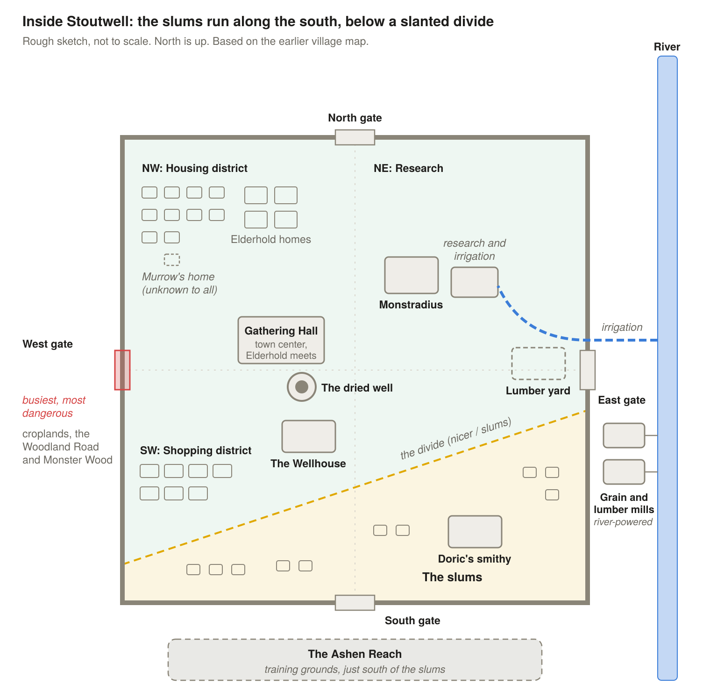
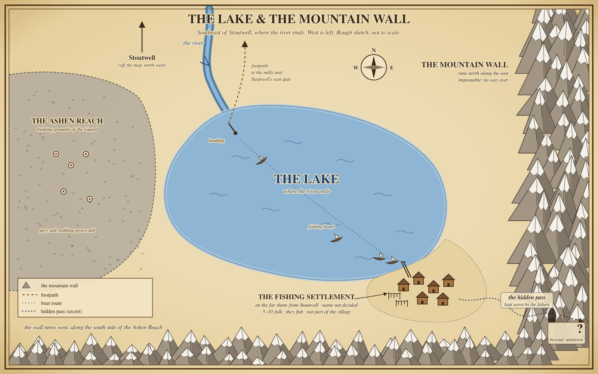

# Stoutwell & Beyond: Universe Draft

2026-11-04 · Sheamus

A working draft of a medieval fantasy universe, built so any place, person or idea can be lifted out and used on its own: in a D&D campaign, a story or a book. It's a work in progress. Names, details and open threads may still change.

## The Universe: The Grand Orrery

An orrery is a clockwork model of the heavens. **The Grand Orrery** is the artificers' name for the universe, picturing its worlds as moving parts in one great mechanism. Only high-ranking and special people, those with a wide enough view to name more than their own world, know it. Most people, Stoutwell's villagers included, have never heard the name.

**The world of Verrowen:** Stoutwell's world is called **Verrowen**. It's a scholarly name, recorded in books. Small villages own only a few books, and only kingdoms keep libraries, so most common folk simply call it "the world" or "the land."

- **Scope:** A universe of several worlds that can tie together. Most of this draft takes place on one of them, Verrowen, centered on the walled village of Stoutwell.
- **Tone:** Medieval fantasy, with D&D-style monsters.
- **Linked worlds:** The worlds connect through **rifts**, random tears that open and close and pull in people, monsters or even whole buildings. That's why the same monsters turn up on different worlds. Arandur, an elf thief, was pulled out of his own world into another (see Characters from Other Worlds).
- **Doorway rifts:** Some artificers can open a rift on purpose, using a doorway as the boundaries for the magic.

## How Magic Works

Magic is everywhere, but it's small. It helps people work. It doesn't do the work for them.

### The core rules

1. **Common but weak:** Almost everyone has a little magic. Very few have a lot.
2. **It assists, it doesn't do:** A fire user can light the stove, but someone still has to cook.
3. **A low ceiling:** A fire user who can boil a pot of water is considered super skilled.
4. **Types:** Everyday magic is elemental: wind, fire or earth. Strength enhancement is a fairly common non-elemental ability, used for anything from hammering hot steel to heavy lifting. Detection magic also exists.
5. **By race:** Elves are the most magical, then humans, then halflings. Humans are more attuned to elemental magic, and wind users, though rare, are far more likely to be human.
6. **Latent magic:** People can have abilities they don't know they have.
7. **Everyday uses:** Mending torn clothes, cracked pots or a nicked shield (maybe a halfling specialty), and earth magic that loosens soil for planting or firms up a muddy path.

### Healers

- **Very rare, and only human:** Healing specialists come strictly from the human race, because of humans' affinity for it.
- **How many:** A small or medium village may have 2 or 3 at a time. Stoutwell has 2.
- **How they heal:** Their magic helps the body heal itself. It doesn't replace natural healing.
- **Artificers:** They aren't healers, but they can still heal. That's how Murrow and Glumtom do it. Artificers lean on natural healing and on using other people's healing magic, often more nefariously.

### Mana

- Nearly everyone has a personal well of **mana** (MP) that fuels their magic.
- Mana refills over time, more slowly than the body heals naturally.
- There's no visible bar or number. People simply feel how much they have left.
- **Mana deprivation:** Running out makes a person sick and dizzy, and can make them pass out.
- **Fire mana and cold:** Fire is the opposite of cold, so a fire user who runs low on mana grows cold. The emptier their well, the deeper the chill.

### Artificers and enchanted items

- **Objects hold magic, they don't make it.** An artificer can take a person's mana and store it inside an object. A stone charged with a fire user's mana warms when fire is cast on it, burning through that supply until it's gone.
- **Attunement:** An item charged with someone's mana normally only works for that person. A very rare ability, almost as rare as being an artificer, lets an item work without its owner present.
- **Artificers** understand every type of magic, even the ones they can't cast. They never lend their own strength. They only let people use their own abilities, whether or not those people know they have them.
- **No awakening:** An artificer can sense latent magic but can't awaken it.

### The Elemental Test

A quiet way to find a child's element before they know it themselves:

1. The child is shown an array of items, such as a stone or a feather.
2. Without a word, the artificer draws a little of the child's mana into an item. The child doesn't know it's happening.
3. The child is naturally drawn to the item they can use, and its reaction reveals their element. A stone that turns weightless means wind.

## Maps

Rough sketches, not to scale.

## Stoutwell

A small, self-sufficient walled village of simple wooden homes, about **600 years old**. Its people live off the land and make what they need.

### The people

- **Population:** About 220.
- **Halflings and humans:** Roughly 72% human (about 158) and 28% halfling (about 62). Halflings live much longer, around 150 years against a human's less than 100, so they have children less often.
- **Elves:** The Wellhouse family, the only elves in the village. They keep to the tavern and are generally ostracized.
- **Halflings:** Short, stout and tougher than they look, with thick skin and natural heat resistance. They're homebodies at heart who love good food and a warm hearth, but they're quick, quiet and lucky when it counts.
- **Work and gender:** Heavy manual work like smithing tends to fall to men because of muscle mass. That's a tendency, not a rule. Nothing is formally restricted.

### What Stoutwell is known for

Unofficially, Stoutwell is known for its **ale** and its **blacksmithing**.

- **The ale:** A local stout that has never lost its potency. Human gatherers specialize in collecting its ingredients. For centuries the supply has been tightly restricted by the lack of water.
- **The smithing:** Stoutwell's smiths are known for ornate work, alongside everyday tools and the Guard's gear.

### The Wellhouse

- The village tavern and bar, serving the local stout.
- It's owned by the wealthy **Wellhouse** family, elves who came to Stoutwell centuries ago out of a soft spot for sharing and caring.
- They have economic ties to the farmers and gatherers who supply the brewing.
- Outside the tavern they want nothing to do with village work.

### Burn, the Wellhouse's regular

- **Who he is:** A short, stout human man of about 45 with a big mustache and a battered red cap, so short he's often taken for a halfling. He's tired of being asked. Everyone calls him **Burn**, for his burns: the one-line roasts he drops from his stool at the Wellhouse bar. Nobody in Stoutwell knows his real name.
- **How he got here:** He came down the Woodland Road with the merchants about fifteen years ago, took a stool at the Wellhouse, and never left. He tells a different story about where he's from every time he's asked. He's one of the few outsiders who lives in Stoutwell.
- **His manner:** Friendly, quick and dry, a little teasing, and never trying too hard. He's been there so long he knows every running joke. He only speaks up when something is actually funny. When he does, it's one line, built on the exact thing someone just said or did, and then he goes back to his stout. He never explains a joke and never tells two in a row.
- **His rules:** He roasts what people say and do, never who they are: not their looks, their people, or their station. He only roasts what he saw or heard himself, and he never makes things up about anyone. Asked straight out who he really is, he won't lie; he makes a joke and changes the subject.
- **The Wellhouses:** He's the one regular who sits and talks with the Wellhouse elves as friends, and they've quietly let his tab run for years. He's warm under the teasing, and the village's mood about the elves is the one thing he's never joked about.
- **Mushrooms:** He swears by the red-capped mushrooms the gatherers bring in from the forest edge and says they make a man grow. They don't. He eats them anyway.
- **Magic:** A little fire. With a snap of his fingers he can light a pipe, a candle or a wick, never more. He's nowhere near boiling a pot of water. On a night with too many snaps he gets cold and sits nearer the hearth.
- **His secret:** He was a jester at court in the Kingdom's capital until a joke landed on the wrong noble. He ran down the Woodland Road before they could find out where he'd gone, and he's been hiding in Stoutwell ever since.
- **Story hooks:** A merchant or the tax representative on the Woodland Road could be someone who saw him at court. Having worked the capital's court, he may know Kingdom names that Stoutwell doesn't, maybe even the surname Osric hides.

### Water and the dead well

- **The name:** Stoutwell was named for its central well, once the source of its famous ale.
- **The blight:** About 550 years ago, the blight dried the well up.
- **Centuries of water runs:** Since then, villagers traveled in small groups to the river and hauled back enough water to refill the dry well for a couple of days at a time.
- **Irrigation:** Recently, the artificer Murrow built an irrigation system that brings river water into the village. The river itself flows away from both the village and the woods.
- **The ale, maybe:** More water could mean more ale for the first time in centuries. Whether it will, and what that would mean for the Wellhouses and whoever controls the supply, is still open.

### Layout

- **Walls:** Short, but not too short, since some monsters are tall.
- **Gates:** One in each wall: north, east, south and west.
- **The west gate:** The croplands, the Woodland Road and the Monster Wood all lie outside it. It's the busiest gate, the most dangerous, and the one goblin raiders hit hardest.
- **The south side:** The Ashen Reach, Stoutwell's training grounds, lies to the south. The slums run along the south wall, right beside it.
- **Why the slums are by the training grounds:** Ash dust and the noise of the drills make the south wall the least wanted land in the village, so it's where poorer families could afford to live. The slums also supply most of the Guard's recruits, so trainees live a short walk from the grounds.
- **Neighborhoods:** The wealth gap shows on the map. There are slums, where poorer families live packed into plainer homes, and a nicer area of better-kept homes and shops.

**Districts:**

- **NW:** The housing district. Middle- to upper-class homes, the Elderhold's included. The slums keep their own separate, poorer housing.
- **NE:** Monstradius, plus Murrow's irrigation and research building, set toward the village center.
- **SW:** The shopping district, on the nicer side but close to the slums. The Wellhouse stands in its northeast corner.
- **SE:** The slums side, home to Doric's smithy.
- **Town center:** Just left of center are the dried well and the large Gathering Hall, where the Elderhold meets.
- **The divide:** The line between the nicer area and the slums runs on a slant, so the shopping district falls on the nicer side.

### History

- The Monster Wood has always been dangerous, even at the founding.
- The story of how Stoutwell was founded was learned once, but never retold. The founders' children were known in their day, but nothing about the founding was passed down.

## Life in Stoutwell

### Groups and jobs

1. **Communal schooling:** The youngest children are taught together.
2. **Placement:** As they grow, the Elders place each villager into a group based on what they're physically suited for. It's meant to be fairly unbiased.
3. **A job within the group:** Each person is given a specific role.
4. **Freedom to switch:** No one is locked in. Someone who is bad at their job can move to another of their choice, within reason.

**The groups:**

- **Village Workers:** Smiths, tanners, woodworkers and other trades inside the walls.
- **Herders:** Cattle, raised for food and leather.
- **Farmers:** The croplands outside the west gate, which take up the most land.
- **Gatherers:** Firewood runs, foragers at the forest edge, and ingredients for the ale.
- **The Guard:** The full-time defenders.
- **The Hearthcircle:** The ruling group.

### Trades

- **Blacksmith:** Doric and his apprentice, Tobin.
- **Tannery:** Leather for clothing.
- **Woodworkers:** Weapon hilts and ornate structures.
- **Farmers and herders:** Crops and cattle.
- **The Elders' scenic cows:** A couple of cows kept just to be looked at, which is a rare luxury.

**Mills and the lumber yard:**

- **Grain mill:** Grinds the harvest into flour.
- **Lumber mill:** Cuts timber into boards and beams.
- **Lumber yard:** It supplies the materials for the village's wooden homes and construction. Between this and the Featherhooks, Stoutwell is more advanced than its size suggests.
- **The millers:** Among the village's wealthier families.

**Where they are:** The mills stand outside the walls on the river to the east, powered by its current. That's opposite the Monster Wood, but still a post the Guard has to cover. The lumber yard is inside the walls near the east gate.

### Firewood and daily magic

- Homes are heated by wood stoves, so firewood is constant work.
- **Chopping:** Humans do about 70% of it. They're leaner and have to work longer to keep up. Stout halflings handle the other 30%.
- **Dead-tree runs:** One or two villagers use detection magic to find fallen trees near the forest edge. A group drags them back while wind users lighten the load and cushion it from below. A Guard escort of a couple of shield-bearers and an archer or two goes along.
- **Foraging:** A small group gathers edible crops from the forest edge.

## Defense and Law

### The Guard

- **Shield-bearers:** Stout halflings fighting from behind big shields they can almost fully hide behind.
- **Archers:** Humans on the walls who shoot down floating monsters and the rare flyer.
- **Full-time guards:** Both men and women. The only requirement is strength.
- **The rotation:** Villagers serve a couple of days a month, rotating between inside the village, the croplands, the walls, and escorting gatherers.
- **Strain:** With so few halflings, the shield Guard is small and overworked. Stress and defiance run high, but extreme punishments keep it to a little skimming and some shift dodging.
- **Funding:** The Guard is paid for communally through the guard tithe. Each household gives a share of its harvest, crafts or labor to keep the Guard fed, armed and paid. Wealthier families, such as the millers, give more, better quality, or both.

### Law and punishment

- **Punishments:** Depending on the crime, from the stocks and floggings to exile and even execution.
- **Weregild:** Payment can be accepted in place of punishment.

## Leadership

Stoutwell is a village, not a kingdom, so it has no king.

- **The Hearthcircle:** The ruling group, something like a royal family. Talented villagers are placed into it, never by birth. That allows some bias, and some corruption.
- **The Elderhold:** The Leader and five Elders, the ones who rose to the top of the Hearthcircle.
- **The Elders:** Five votes, an odd number so there are no ties. They work together to advise the Leader, focused on research, survival and peace. Their focuses separate naturally, without formal titles.
- **The Leader:** Doesn't vote. He's the translator and spokesperson for the Elders.
- **Getting a seat:** A Hearthcircle member rises to the Elderhold only when a seat opens, and then by vote.
- **Why the Elders are halflings:** The oldest villagers in physical years are almost always halflings.

### Corruption

The corruption comes from the Elderhold. Two of the five Elders currently work together to commit it:

- Favorites get placed into easier jobs.
- Favored crop workers get bigger harvest shares.
- Skimming from the guard tithe goes unpunished.

## The People of Stoutwell

### Tobin Ashby

- **Male halfling, 33.** Young but fully grown for a halfling.
- **Role:** Blacksmith's apprentice. He was born into a smithing family, and the Elders placed him at the forge.
- **Personality:** Determined, loyal and efficient.
- **Magic:** Minimal. He uses a strength enhancement to hammer hot steel harder.
- **Where his story is heading:** The goblin raids aren't random. He follows the trail back toward the Blight, and to whoever, or whatever, is behind it.

### Doric

- **Male halfling, 67,** in the younger part of his prime.
- **Role:** Master blacksmith and Tobin's master.
- **Personality:** Strict because he hates mistakes, and deeply proud of his work.
- **Standing:** He isn't in the Hearthcircle, but he advises them on metalwork. They respect him but don't rely on him.
- **Sore spot:** The Hearthcircle orders its fine metalwork from the capital instead of from him, and for a smith this proud, it stings.
- **On Tobin:** Talented, but not ready to take over.
- **Murrow:** They're acquaintances. Doric forges the iron for Murrow's Featherhooks.

### Osric, Leader of the Elderhold

- **Male halfling, 142.** That's within the Elders' age range but younger than the eldest, which keeps him in touch with the present.
- **Background:** He came up from near the bottom, close to peasant. He worked his way into the Guard, then the Hearthcircle, then the Elderhold. Respect made him Leader. He rose mostly fairly, with perhaps a favor or two called in.
- **Public face:** Warm and well-liked.
- **Underneath:** Very calculating, well educated, and careful with every word.
- **The corruption:** He's not part of it. He suspects it but has no proof, so in practice he lets it continue.
- **Secret:** His real surname, which he keeps hidden, ties him to someone high up in the Kingdom. Almost no one else knows.

### The Elders

All five are halflings.

| Elder | Age | Leans toward | Notes |
| --- | --- | --- | --- |
| **Wendeline Brackenford** (F) | 149 | Peace | The eldest. Keeper of customs. Gentle but stubborn. |
| **Fenwick Larkspur** (M) | 145 | Survival | Ex-Guard. Blunt and practical. Respects Hesketh. |
| **Bertram Quillby** (M) | 138 | Research | Keeps the records, ledgers and tithe counts. Precise and polite. **Corrupt.** |
| **Ysolde Ambergate** (F) | 133 | Survival | Oversees harvest stores and rationing. Charming and persuasive. **Corrupt.** |
| **Clementine Rook** (F) | 131 | Research | The newest Elder. Curious about magic, and the one who deals with Murrow. |

**The corrupt pair:** Bertram's ledgers make the skimming vanish on paper, and Ysolde steers the harvest shares. Together they shape placements.

### Hesketh Reeve, Captain of the Guard

- **Male human, 48.**
- **Role:** Picked from the ranks for his prowess. A human placed over a mostly halfling Guard, which reflects the village's built-in bias.
- **Character:** Fair and harsh, but not corrupt.
- **On weregild:** He dislikes it, but accepts it because it's the law.
- **Osric:** They served in the Guard during the same years, but were routinely on opposite shifts and never really knew each other.

### Murrow, the Artificer

- **Race:** Unknown. He's neither human nor halfling, and he hides his figure under heavy robes and a hood so deep it looks like a permanent scowl.
- **Age:** Over 550 years. He has been in Stoutwell longer than anyone can remember. No one knows how he got there. He won't say, and nobody asks.
- **The shop:** **Monstradius**, his workshop and storefront in the nicer part of the village.
- **His home:** About three blocks from the shop, in the NW housing district, hidden in plain sight among the other homes. It's comfortable but unremarkable, and no one knows it's his.
- **Personality:** Cold and businesslike, the "let me fix this and get out of my hair" type. Never mean. Completely closed off about himself.
- **What he does:** Everyday enchantments, healing and combat help, always by channeling other people's own magic.
- **Business:** Coin or barter, and the same terms for everyone. His rare goods cost more than people expect.
- **The Elderhold:** They don't know what he can really do. They only know that if you ask, it gets done.
- **The Elemental Test:** He tests children who come to him injured, framed as part of their healing, and only when a child has unknowingly shown that magic could help them.
- **Why he's secretive:** His upbringing, and the certainty that the Kingdom would use someone like him unjustly. He fears the Kingdom above all.
- **Research:** He can cast a spell that hides him from magical detection, but it wears off. He's working on putting it into a permanent item.
- **Soft spot:** He has one, for one particular kind of person. Who that is hasn't been revealed yet.

### Murrow's items

- **Hearthstones:** Smooth river stones charged by a fire user in Murrow's shop, set to release slowly so a stove stays warm through the night. One night per charge, and they still need embers: they warm a fire but don't replace it. Rare and expensive.
- **Featherhooks:** Iron hooks forged by Doric and imprinted by Murrow with a wind pattern. They cut a log's weight about in half while it's dragged, drawing on the holder's latent wind, so they work better for humans than halflings. Holding one too long leaves you winded.
- **Wardbells:** Bells on the walls with a detection user's sense set into the metal, pointed at the Monster Wood. They ring on their own when something large comes out, but can't tell goblins from trolls, only big from small, and need a detection user to refresh them every few weeks.
- **Truthglass:** A rare piece of clear quartz charged with detection magic. It shows whether a coin, seal or signed paper is real, but only answers real or fake, never who forged it or why. Dangerous for anyone skimming the guard tithe, or for a crooked tax representative.
- **The Rift compass:** A secret project, about 80% complete. It points toward places where the worlds are thin. How it works is unknown even to Murrow, and it may use a kind of magic nobody in the village has.

## The Monster Wood

- A dark wood to the west of Stoutwell where monsters spawn. It has always been dangerous.
- **Goblin raiders:** The main threat. They raid the croplands outside the walls.
- **Trolls:** They're natural to the deep woods, the same kind of creature as in Arandur's world. The village's defenses keep them from being a problem.
- **Large beasts:** They live in the deep woods. The ones known so far are **hollowstags** (stags nearly fifteen feet tall at the antlers, whose hollow antlers whistle as they run), **rootwyrms** (serpents as thick as a mill wheel that live in the roots under the deep woods) and the ancient **Mosswarden**, a beast so old a small forest grows on its back. Their stat lines are in [`bestiary.md`](bestiary.md).
- **Tall and floating monsters:** These shaped the walls and the archers. Hollowstags are the tall kind; **driftmaws**, cart-sized gasbags that drift above the canopy trailing sticky tendrils, are the floating kind. True flyers are rare; the **gloamowl**, a dog-sized owl that hunts at dusk, is one of the few.
- **Driven out by the Blight:** As the Blight kills the roots and dries the ground, it's pushing the deep woods' creatures, **thornback boars** among them, out toward the edges and west toward the Kingdom.

### The Blight

- An old blight that has been eating through the deep woods for at least 550 years. It's what killed Stoutwell's well.
- It has finally reached the goblins' part of the forest. They're fleeing it, desperate for a safe place. They can't get past the walls, so they raid the fields for food and survival.
- Whether the blight is natural or deliberate is still unknown.

## Beyond the Village

- **The Kingdom:** A real kingdom farther off, past the woods. Stoutwell sits on its far edge. Like any kingdom, it carries moral corruption and the cruelty that comes with power. The full notes are in [`working-notes.md`](working-notes.md) under Beyond the Village.
- **The Kingdom runs on paper:** Its power is its rolls: the census, the tax rolls, the draft list, the register of artificers and GuildScribe's parchments, all kept in the **Rolls House** beside the Crown's seat. A name on paper can be taxed, drafted, fined or found. Its corruption is mostly about whose names get written, lost or moved.
- **The Crown and the great houses:** The monarch is a distant banner. A handful of noble houses hold the offices that matter (keeper of the rolls, master of the mint, warden of the roads, master of the draft) and pass them down like property. Osric's hidden surname could belong to one of them.
- **The draft and the register:** Registered citizens get the Kingdom's law, its markets and bounty coin, and can be drafted. Every artificer the Kingdom finds is written into the register and put to work, the way Glumtom was. Enchanted items made in the Kingdom carry a registered artificer's mark.
- **The deal at the edge:** The census stops at the Monster Wood. Stoutwell pays its Kingdom tax as one lump sum through the tax representative instead of being counted name by name, so no one there has ever been drafted, and Murrow can live there unregistered. One guild ledger could end the arrangement.
- **The capital and the heartland:** The capital is a walled city west of the Monster Wood, at the far end of the Woodland Road and the Clerk's road. Around it lies the heartland's farmland and river towns, the source of grain, wool and timber; coin is minted in the capital. Inside are the Crown's seat and the Rolls House, the mint, the workshop quarter where the Hearthcircle's fine metalwork is made, GuildScribe's hall and arena, the market square with the peddlers' stall, and Glumtom's workshop. The poor quarters sit outside the old wall. Eastward, the towns and waystations grow poorer and less watched. Merchants hire their escorts at the last waystation, where the Woodland Road leaves for Stoutwell.
- **History:** The Kingdom grew outward from the capital over centuries, writing each new town into its rolls, until it reached the Monster Wood and stopped, because the wood was cheaper to tax around than to cross.
- **The Woodland Road:** A path through the woods, outside the west gate, to the Kingdom. It's relatively safe, but still dangerous.
- **Merchants:** Traders travel the road with safety escorts, so the village isn't cut off. The wealthier Hearthcircle trades with them most and gets the best goods, including most of its fine metalwork, from the Kingdom's capital.
- **The tax representative:** Travels with the merchants to collect the Kingdom's tax. The role is chosen carefully to keep bias low, but the Kingdom's corruption can still creep in.
- **The lake:** The river flows south past the mills and opens into a lake at its southern end, southeast of Stoutwell.
- **The mountain wall:** An impassable wall of mountains runs along the east and turns west along the south, and the lake lies in its corner. No one goes over it. Its southern arm runs past the Ashen Reach, so the training grounds sit between the village and the mountains.
- **The fishing settlement:** A small fishing settlement on the lake's far shore, across the water from Stoutwell, at the foot of the mountains. Usually only 5 to 10 people live there. They fish, and they aren't part of the village, but their catch is a source of food for Stoutwell. Its name isn't decided yet.
- **The hidden pass (secret):** The fishers secretly guard and hide a passage through the mountains. It leads to somewhere on the other side that no one in Stoutwell knows of. What's there is still to be decided.
- **The Ashen Reach:** A plain of grey soil to the south of Stoutwell where nothing grows tall. It's the village's training grounds. The slums along the south wall sit right beside it: the ash and noise keep land there cheap, and the slums supply most of the Guard's recruits. Some say it's an old battlefield, others that a past Grand Orrery event touched down there.
- **The divination tower:** A tower somewhere past the Kingdom, farther off than anywhere Stoutwell knows. Who keeps it, and what it sees, is still to be decided.

### GuildScribe, the Kingdom's guild hall

- **What it is:** The adventurers' guild hall in the Kingdom's capital. It's named for its **guildscribes**, the clerks who keep every record the hall runs on. There's nothing like it in Stoutwell. A village that small has the Guard, not a guild.
- **The parchment:** Every adventurer who joins is written onto a parchment: name, race, trade, level of skill and deeds. Their rank in the hall rises as the parchment fills.
- **Companies:** Adventurers register in companies, small parties that take work together under one name.
- **The Archives:** The guild's library of spells, items, rules and monster lore. It's one of the few places in Verrowen where that knowledge is written down.
- **The bounty board:** Monster bounties, paid in Kingdom coin (gold, silver and copper). The guildscribes keep a bestiary of every creature a bounty has been posted for.
- **The arena:** Sanctioned duels between members, for coin and standing.
- **The Kingdom's hand:** The hall serves the Kingdom first. Its records and its corruption both belong to the Kingdom.
- **The draft pool:** Joining the guild puts your name on the Kingdom's books, and registered citizens can be drafted. A census every season catches everyone who never joined, so they end up in the draft pool too.
- **Adventurers in the wood:** Only a few adventurers hunt the Monster Wood, coming in from the west on the Kingdom's side. None have made it past the blighted section where the goblins live, so none have reached Stoutwell.
- **The bestiary's blank page:** GuildScribe has posted bounties for the beasts the Blight is driving out, but no one has ever brought back proof of the deep woods' great beasts. The first company to return with a hollowstag antler would make its name.

### The Scribe, the peddlers and the Wandering Clerk

- **The Scribe:** GuildScribe's senior guildscribe, who answers adventurers at the desk. Sour, unimpressed and always comparing things to how they were done in her day, she scolds young adventurers for not eating enough. She secretly cares a little, and would never admit it. Anyone who tries to rob her is fined into the hall's swear jar.
- **The peddlers:** Threadbare traders who take turns at an open stall in the capital's market square. They haggle hard and sell odd, mostly honest wares. Now and then one turns up a real relic and can't say where it came from. (Fenwick Loose-Coin and Widow Hesk are no relation to Fenwick Larkspur or Hesketh Reeve.)
- **The Wandering Clerk:** A guildscribe who broke from the hall and keeps a ledger of their own on the Kingdom's roads, swearing in adventurers where there's no guild, posting bounties and sending them to the nearest peddler's stall. Some of the peddlers follow the Clerk's road.
- **The first ledger in Stoutwell:** The Clerk's road, by way of the Woodland Road, could bring the first guild ledger to Stoutwell, putting villagers' names on paper the Kingdom might read.
- **A relic from the wood:** One of the peddlers' unexplained relics could have come out of the Monster Wood.

### Where GuildScribe's people live and travel

Every one of them lives in the Kingdom or travels through it, on the side that borders Stoutwell. None of them lives in Stoutwell.

- **The Scribe:** An old human woman who lives in two rooms above the hall in the capital and has kept its desk longer than anyone can say. She hasn't left the capital in years and sees no reason to.
- **The Wandering Clerk:** Keeps no home. The Clerk's road loops through the Kingdom's small towns and waystations out to its far edge, where the Woodland Road runs through the woods to Stoutwell's west gate. The Clerk often travels that last stretch with the merchants and their escorts.

#### The capital peddlers

They live in the capital and work the stall in its market square.

- **Bregga Stumpteeth:** Human, F. A broad, gap-toothed hawker whose voice carries across the whole square. Sells anything that can be sold by shouting.
- **Widow Hesk:** Human, F. Has been "recently widowed" for as long as anyone has known her. Runs her pitch on sympathy and is very good at it.
- **Fenwick Loose-Coin:** Halfling, M. Always a copper short, and always sure the next sale will fix it. Owes a little to most of the other peddlers.
- **Marda the Reformed Cutpurse:** Human, F. A former pickpocket who went straight and won't let anyone forget it. Still checks every buyer's pockets with her eyes.
- **Grithnall the Threadbare:** Human, M. Lanky and patched from hat to boots. Claims his coat was once a lord's. It may have been.
- **Ossop the Unlucky:** Human, M. Whatever can go wrong at his stall does: the table tips, the awning leaks, the chicken gets loose. Buyers pity him into sales.
- **Beren Halfcoat:** Halfling, M. Lost half his coat (and the story keeps changing about how). Neat, polite, and the most honest haggler in the square.
- **Ivy Scraptongue:** Human, F. Sharp-tongued and quick, she trades insults with buyers and wins. Deals mostly in scrap metal and salvage from the capital's workshops.
- **Doras Milkbeard:** Human, M. An old man with a long white beard who sells "remedies" of dubious use. Most of them are just tea.
- **Ruel Tinkpocket:** Halfling, M. A tinker whose coat is lined with pockets of small broken parts. Fixes cheap trinkets while he haggles.
- **Podge Ashborn:** Halfling, M. Round, cheerful and covered in soot, he sells secondhand pots, lanterns and anything that's been near a fire.
- **Uther Nine-Debts:** Human, M. Owes nine debts to nine people, and keeps careful count. Sells fast and cheap to stay one step ahead of all nine.

#### The road peddlers

They follow the Wandering Clerk's road through the Kingdom, setting up wherever the Clerk stops, and take their turns at the capital stall when the road brings them back. Some of them travel the Woodland Road with the merchants, as far as Stoutwell.

- **Wobble:** Halfling, M. Walks with a rolling gait and pushes a cart with one bad wheel. The first to unpack, the last to leave.
- **Pruneface Yorik:** Human, M. Wrinkled, scowling and older than he admits. A miser who drives the hardest bargains on the road.
- **Tansy Ninefingers:** Human, F. Lost a finger to something in a sack she shouldn't have opened. Has turned up more real relics than any other peddler, and asks the fewest questions.
- **Old Corrin:** Human, M. The oldest peddler on the road. Knows every waystation, every shortcut and every story, most of them true.
- **Tam Pockets:** Human, M. Young and quick-handed, his coat is more pocket than coat. Nobody is quite sure what's in all of them.
- **Squint:** Halfling, F. Nearsighted and unwilling to admit it. Inspects every coin so closely that she's never been cheated.
- **Nan Gullyfoot:** Halfling, F. A grandmotherly peddler with tired feet and a pack of knitted goods. Feeds anyone who looks hungry, whether they buy or not.
- **Kettle:** Human, F. Hauls a clanking pack of pots and tea things, and always has a kettle on. Gossips over every cup.
- **Sella Windrags:** Human, F. Sells cloth, scarves and rags that flap from every part of her pack, so you can see her coming a mile down the road.

### GuildScribe's adventurers

The adventurers written onto GuildScribe's parchments. Each one is a character the guild hall (the GuildScribe bot) made for a viewer in a stream's chat, and the name in brackets is the viewer who plays them (left out where the character goes by the viewer's own name).

- **Where they are:** All of them are registered at the hall in the Kingdom's capital. They take bounties across the Kingdom, and the boldest hunt the Monster Wood from its western edge. Like every adventurer so far, none has made it past the blighted goblin lands, so none has reached Stoutwell.
- **Who they are:** A wider mix of peoples than Stoutwell ever sees. Alongside humans, halflings, elves and gnomes, the hall's parchments list dwarves, drow, half-orcs, dragonborn and tieflings.
- **Rank:** A parchment's rank rises as it fills: **Novice** (level 1 to 2), **Journeyman** (3 to 5), **Seasoned** (6 to 10) and **Veteran** (11 and up).
- **Companies:** Science Club (Sun, MuzzledKitty, Blackass), Nuthaus (Xan, Briarpike), No Trolls Here (nobody, Momma_Enya), Touching (nobody, Momma_Enya, jeredth), the Dweebs (Fel) and Dev (Shadowflame).

#### Veterans

- **nobody** (e_paco): a mountain dwarf barbarian, level 12. Companies: No Trolls Here and Touching.
- **Momma_Enya** (enya_celosia): a dragonborn warlock, level 12. Companies: No Trolls Here and Touching.
- **Fel** (felivor): a drow elf fighter, level 12. Company: the Dweebs.
- **MuzzledKitty** (fridaynytes): a tiefling wizard, level 12. Company: Science Club.
- **Stabitha** (majornarsilion): a human rogue, level 12. No company.
- **Sun** (sunaysaurus): a high elf monk, level 12. Company: Science Club.
- **nogood59** (yesevil95): a forest gnome cleric, level 12. No company.
- **Blackass** (strawberrystellas): a dragonborn druid, level 11. Company: Science Club.
- **Xan** (xannyxia): a tiefling druid, level 11. Company: Nuthaus.

#### Seasoned

- **Briarpike** (rinkaneko): a forest gnome druid, level 8. Company: Nuthaus.
- **Shadowflame** (stonedsheamus): a half-orc rogue, level 8. Company: Dev.
- **Mistkettle** (trixiedahmer): a dragonborn bard, level 8. No company.
- **Grimknot** (dnicholson1021): a stout halfling fighter, level 7. No company.
- **jeredth**: a lightfoot halfling ranger, level 6. Company: Touching.

#### Journeymen

- **Quack** (a_ducky_on_quack): a stout halfling fighter, level 5. No company.
- **Ryos** (married_with_consoles): a tiefling rogue, level 3. No company.
- **smokeeeg**: a lightfoot halfling rogue, level 3. No company.
- **Moonkettle** (theghrym): a dragonborn fighter, level 3. No company.

#### Novices

- **blickysnicky**: a lightfoot halfling monk, level 2. No company.
- **Cinderfoot** (sirenwolfx): a dragonborn ranger, level 2. No company.
- **antispinth1s**: a dragonborn sorcerer, level 1. No company.
- **chaoticwaterdragon**: a lightfoot halfling monk, level 1. No company.
- **Conanski** (conan9287): a lightfoot halfling bard, level 1. No company.
- **Ironmantle** (humanoidrope): a blue dragonborn ranger, level 1. No company.
- **itsrybread**: a half-orc bard, level 1. No company.
- **Bramthistle** (kacearrito): a rock gnome wizard, level 1. No company.
- **Mistcrest** (lyghtable): a half-orc rogue, level 1. No company.
- **morathisshadowweaver**: a half-orc warlock, level 1. No company.
- **Hawkthistle** (ninasmash): a half-orc wizard, level 1. No company.
- **Thunderwing** (pahtoonyah_): a forest gnome warlock, level 1. No company.
- **Bramblehelm** (sirleafytheslightlyinsane): a tiefling paladin, level 1. No company.
- **undercovermario**: a tiefling ranger, level 1. No company.
- **x3zero**: a tiefling cleric, level 1. No company.

### Glumtom, the Kingdom's artificer

- **Rock gnome artificer,** gloomy-looking and quiet, who keeps to himself.
- **Background:** A lifelong tinkerer who ran a repair workshop. As a registered citizen of the Kingdom, he was drafted into its service.
- **Now:** He works out of a workshop in the capital, where he's unofficially kept. He's well paid, mostly through funding for his research. He works *for* the Kingdom, not *with* it.
- **What he does for them:** He heals wounded guards and warriors, builds tools and weapons (but never fights), helps with construction, and raises a few undead to help rebuild and build walls and buildings.
- **His craft:** He raises dead creatures, builds constructs from dead parts, and repairs smaller broken things.
- **Family:** He's distant family to Murrow. Murrow knows Glumtom works for the Kingdom, but not whether it's by choice.

### The Seeker's Lodestone

- A secret artificer-made item, known only among artificers, that locates other artificers. The Kingdom doesn't know it exists.
- It's a perfectly round, flat disc of *mirrorstone*, a rare black glass with a reflective surface, shaped by magic. An arrow of light rises from it and points toward another artificer, drawn by a blend of many mana types.
- Glumtom has one. He could find Murrow, but he isn't looking, and Murrow doesn't know the Lodestone exists.

## Characters from Other Worlds

### Arandur

An elf ranger and pickpocket from a different world: an elven wood beside a growing human city.

- **Childhood:** He grew up in an isolated cabin, raised by his hunter mother **Silwen**, who taught him stealth and tracking and told him warning tales about trolls. His father, **Faelan**, was distant.
- **Loss:** His parents went out "hunting" and never came back. The nearby elven village abandoned him, and the city seized his family's land.
- **The spectre:** A speechless, formless spectre taught him to track and kill. He suspects it was Silwen, bound and voiceless but not gone.
- **The streets:** Homeless and shut out of work as a foreigner, he became a thief and taught himself archery by watching soldiers.
- **Two in one:** His small flickers of magic may not be his own. They may be Silwen acting through him.
- **Personality:** He buries everything under contempt and silence. He talks down magic loudly. He fears trolls but can't fully hate them.
- **Verrowen:** In his youth, a rift dropped him in a village near Stoutwell. The village's name is still to be decided.
- **Now:** He has been pulled out of his world into another: **Midkemia**, where he travels in a wagon with a party searching for the missing Queen of Dannonirn. Midkemia has its own document, [`midkemia.md`](midkemia.md).
- **At the table:** He's fixated on fire and trolls, wears clicking high heels and steals from his own party for fun.

## Still Being Developed

- Is the blight natural, or is someone behind it?
- What else lives in the deep woods, past the hollowstags, rootwyrms and the Mosswarden?
- Which artificers can open doorway rifts, and do Stoutwell's story and Arandur's ever cross?
- What does Verrowen look like beyond the Kingdom and the Monster Wood?
- What lies on the other side of the mountains, through the fishers' hidden pass, and why do they keep it secret?
- Who keeps the divination tower, and how does divination fit with the known kinds of magic (elemental, strength, detection)?
- What is Murrow, and who is his soft spot for?
