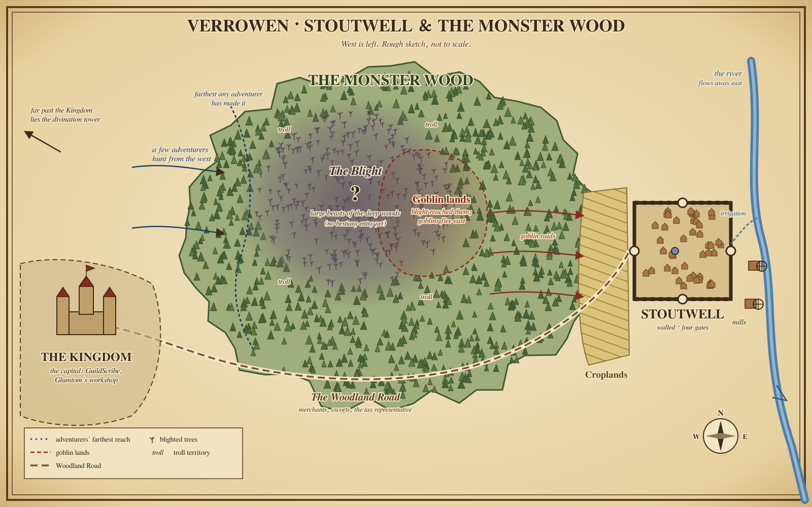
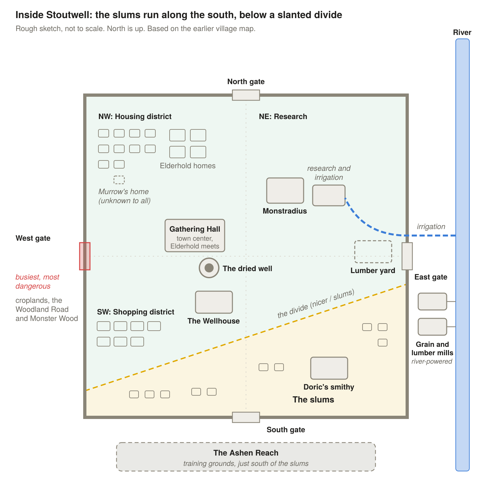
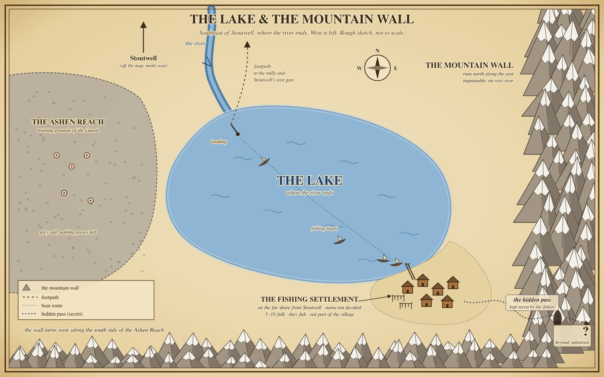

# Village Hero: Character & Story Notes

2026-11-04 · Sheamus

Working notes for a new character and his story. Sections marked **Your idea** are what you've decided. Sections marked **Pitch** are suggestions to pick from, change or toss.

## The Big Picture (Your idea)

- **What this is:** A worldbuilding bible: a detailed universe with worlds, societies and people. There's no set use yet. If you write a book later, you can pull parts out of here.
- **Scope:** A whole universe, not just one world. This character's world is a new one, separate from Arandur's, but the two can tie together.
- **Arandur:** Your D&D character, an elf pickpocket thief who got transported somewhere else. That's a built-in link between worlds.
- **Monsters:** D&D-style monsters.
- **Magic:** Very common, but most people only have a little of it. Magic assists with everyday tasks rather than doing them. From most to least magical: elves, then humans, then halflings.
- **Theme:** Medieval fantasy.
- **Universe name:** **The Grand Orrery.** An orrery is a clockwork model of the heavens, and this is the artificers' name for the universe, picturing the worlds as moving parts in one great mechanism. Only high-ranking and special people, those with a wide enough view to name more than their own world, know the name. Most people, including the villagers of Stoutwell, have never heard it.
- **World name:** **Verrowen.** This is Stoutwell's world. The name is scholarly, recorded in books. Small villages like Stoutwell own only a few books, and only kingdoms have libraries, so most villagers just call it "the world" or "the land."

## Maps (rough draft)

Rough sketches of what's decided so far. They aren't to scale.

## The Character (Your idea)

- **Gender / age:** Male, 33. That's young but fully grown for a halfling.
- **Name:** Tobin Ashby. Ashby is a smithing family name.
- **Race:** Halfling, inspired by the hobbits of *The Lord of the Rings* and *The Hobbit*.
- **Day job:** The blacksmith's apprentice.
- **Why smithing:** He was born into it, and the Elders placed him there.
- **Personality:** Determined, loyal and efficient.
- **Magic:** Minimal. He has a strength enhancement that he uses while blacksmithing to hit hot steel harder.
- **His master:** Doric, the village blacksmith, a strict male halfling.
- **Home:** A small village (see The Village).

### Halfling traits (Your idea)

What gives him that cozy hobbit feel:

- **Homebody at heart:** He loves good food, a warm hearth and a quiet life, so getting pulled into danger is a big deal for him.
- **Small but sneaky:** Halflings are naturally quick, quiet and lucky. That's handy against monsters twice his size.
- **Outsider among the big folk:** Leaving the village means a world built for taller people, which is good for both humor and grit.
- **Living with big folk:** His village is mixed halflings and humans, so he's grown up being the short one in a crowd. That can be a running joke or a sore spot.
- **Thick skin:** Halflings are stout, with thicker skin and natural heat resistance, so they're well suited to blacksmithing.

## The Village (Your idea)

The feel is borrowed from the elven village near Arandur's home, but it's set in this character's own world, not Arandur's.

- Small, made up of simple wooden homes.
- Self-sufficient: they build and make what they want and need themselves.
- They live off the land, with vegetables and fruit grown right in the village or close by.
- **Village name:** Stoutwell.

### Who lives there (Your idea)

A mix of halflings and regular, full-sized humans living side by side.

- **Population:** About 220 people, a smaller village.
- **The split:** About 72% human (around 158 people) and 28% halfling (around 62 people).
- **Why so few halflings:** Halflings live longer, so they have children less often.

### What Stoutwell is known for (Your idea)

Unofficially, Stoutwell is known for two things: **its ales and its blacksmithing.**

- **The ales:** The village brews its own local stout. The human gatherers specialize in gathering ingredients for the stout ales.
- **The blacksmithing:** The smiths make ornate items, on top of everyday tools and the Guard's gear.

### The tavern (Your idea)

- **Name:** The Wellhouse.
- **What it serves:** The local stout.
- **Owners:** It's owned by the Wellhouse family, who are wealthy. They're elves, the only elves in the village. They have a soft spot for sharing and caring, which is why they relocated to Stoutwell centuries ago. There are no elves anywhere in the village outside the tavern. The village typically ostracizes them, and they don't want to do anything for the village beyond the tavern work.
- **Ties:** It has economic ties to the farmers and gatherers, who supply the ingredients for the stout.

**The ale over the centuries (Your idea):** The ale never lost its potency. But once the well dried up and water had to be hauled from the river, the ale supply became very restricted.

**Irrigation and the ale (Your idea, left open):** Murrow's new irrigation could mean more water, and possibly more ale for the first time in centuries. Whether that actually happens, and what it would mean for the Wellhouses' wealth and for whoever controls the supply, isn't decided yet.

### Water (Your idea)

- **The river:** It flows away from the village and away from the woods.
- **The dried well:** There's an old well in the middle of town, but it has dried up.
- **Clean water:** Because the well is dry, the artificer (Murrow) created an irrigation system that brings water from the river into the village.

**Where the name comes from (Your idea):** Stoutwell is named after its well, which was once the source of the village's amazing ale.

**When the well died:** About 550 years ago, after the village had already gotten its name. **The blight caused it to dry up.**

**Water through the centuries (Your idea):**

- **Before irrigation:** For centuries, villagers traveled in small groups to the river and brought back enough water to refill the dry well, which then lasted a couple of days.
- **Now:** Murrow's irrigation is recent, a product of his research. It ended the water runs.

### The walls & gates (Your idea)

- There's a gate in each wall: north, east, south and west.
- **The west gate:** The croplands, the Woodland Road and the Monster Wood all lie to the west, outside this gate. That makes it the busiest and most dangerous gate, and the one goblin raiders hit hardest.

### History (Your idea)

- **Age:** Stoutwell is about 600 years old.
- **The woods:** The Monster Wood has always been dangerous, even when the village was founded.
- **Lost founding stories:** The stories of how Stoutwell was founded were learned but never retold. The founders' children would have been known in their day, but nothing about the founding was passed on.

### Neighborhoods (Your idea)

The wealth gap shows on the map. Inside the walls, the village splits into poorer and nicer areas.

- **The slums:** The poorer part of the village, where families with little live closer together in plainer homes.
- **The nicer area:** Better-kept homes and shops. Monstradius, Murrow's shop, is here.
- **The edge:** Where the slums meet the nicer area. The line runs on a slant across the village (see Village layout).

**Village layout (Your idea):**

- **NW quadrant:** The housing district. Middle- to upper-class homes, the Elderhold's included. The slums keep their own separate, poorer housing.
- **NE quadrant:** Monstradius, plus Murrow's irrigation and research building. They sit toward the center of the village.
- **SW quadrant:** The shopping district, part of the nicer area but close to the slums. The Wellhouse is here, in the district's northeast corner.
- **SE quadrant:** The slums side, where Doric's smithy is.
- **Town center:** Just left of center stand the dried well and a large Gathering Hall, where the Elderhold meets.
- **The divide:** The line between the nicer area and the slums runs on a slant, so the SW shopping district falls on the nicer side.

### Defenses (Your idea)

The village is a safe place where the monsters can't get in.

- **Walls:** The village is walled in. The walls are on the shorter side, but not too short, because some monsters are tall.
- **The Guard (halflings):** Stout halflings who fight from behind big shields. Being short means they can tuck almost completely behind them.
- **Archers (humans):** Humans with bows on the walls, there to shoot down the floating monsters (and the few that fly).

### The Guard rotation (Your idea)

Villagers take turns on the Guard rotation a couple of days a month, not a few times a year. The rotation moves between four posts:

1. **Inside the village:** helping the villagers within the walls.
2. **The croplands:** protecting the farmers outside the walls, where the goblins raid.
3. **The walls:** shields and archers on watch.
4. **Gathering escort:** a couple of shield-bearers and an archer or two who go out with the gathering groups.

**Full-time guards:** Some guards serve full time as part of a larger Guard group, and the rotation fills in around them. The Guard includes both men and women. The only requirement for full-time guards is strength.

**A small halfling Guard (Your idea):** Halflings are only about 28% of the village (around 62 people), so the halfling shield Guard stays small. Being so few leaves them more fatigued, which raises overall stress and defiance in the Guard. Defiance stays minimal, though, because the punishments are extreme. It mostly shows up as a little skimming and some shift dodging.

**The Guard Captain:** A human. Putting a human in charge of a Guard that's mostly halfling shield-bearers is part of the village's built-in bias. He's fair: harsh, but not corrupt. His name is Hesketh Reeve. He's 48.

### Leadership (Your idea)

It's a village, not a kingdom, so there's no king.

- **The Leader:** The village chief who rules the village. A halfling, 142 years old. He's in the Elders' age range but younger than the oldest of them, which keeps him more in touch with what's happening now.
- **The Elders:** A group of the oldest villagers, around 130 to 150 years old. They're slower but wise, and they advise the Leader.
- **Why halflings end up as Elders:** In D&D, halflings reach adulthood around 20 and live to about 150, while humans rarely pass 100. The oldest villagers in physical years will almost always be halflings.

**The Hearthcircle (Your idea):** The ruling group, a bit like a royal family. The more talented villagers get placed into it. That keeps a little bias in the system and opens the door to some corruption. Placement is never hereditary.

**The Elderhold (Your idea):** The Leader and the Elders together. They're the ones who survived through the Hearthcircle and rose to the top of it.

**The Elders (Your idea):**

- **Size:** 5 Elders, an odd number to avoid tied votes. Osric doesn't vote. He acts as the translator and spokesperson for the five Elders.
- **How they work:** They work together and advise the Leader. No Elder is officially in charge of any one area, but their focuses naturally separate.
- **Their main focus:** Research, survival and peace.
- **Getting a seat:** A Hearthcircle member rises to the Elderhold only when a seat opens, and then by vote.

**Corruption in the Elderhold (Your idea):**

- The corruption comes from the Elderhold.
- Placements are part of how it happens. Right now, only 2 of the Elders are corrupt, and they work together to commit it.
- **Easier jobs:** Favorites get placed into easier jobs.
- **Bigger harvest shares:** Favored crop workers get a bigger share of the harvest.
- **Skimming:** People get away with skimming from the guard tithe.

### Law & punishment (Your idea)

- **Punishments:** Depending on the crime, they range from the stocks and floggings to exile and even execution.
- **Weregild:** Weregild is accepted, meaning payment can be made in place of punishment.

### Paying for the Guard (Your idea)

The Guard is paid for communally, which means there's some hierarchy. Some families have wealth and some don't. Overall the village is communal and peaceful, without much internal trouble.

### The guard tithe (Your idea)

- **The guard tithe:** Each household gives a share of its harvest, crafts or labor to keep the Guard fed, armed and paid. Wealthier families, such as the millers, give more, better quality, or both.

### Daily life: firewood & magic (Your idea)

Magic helps with everyday work, but people still do the work themselves.

**Heating:** Homes are heated with wood stoves that burn firewood, so the village needs a steady supply of chopped wood.

**Who chops:**

- **Humans do about 70% of the chopping.** They're leaner and have less muscle, so they have to work longer to get a similar, respectable amount done.
- **Halflings do about 30%.** They're short but stout and brutish for their size.

**Gathering dead trees (a group job):**

1. **Finding them:** One or two villagers with detection magic find fallen dead trees lying in the forest near its edge.
2. **Moving them:** The rest of the group drags the trees out. Wind magic reduces the weight and creates a cushioned barrier underneath to make moving easier.
3. **Why it's a group:** A tree takes many hands, plus the magic users, which explains why villagers go out in groups.
4. **Protection:** A Guard escort goes with them: a couple of shield-bearers and an archer or two, as part of the Guard rotation.

**Foraging:** A small group gathers edible crops from the edge of the forest.

**Magic by race:**

- Humans are closer to elves in magical ability than halflings are, so they're more attuned to elemental magic.
- Wind magic users are still rare, but much more likely to be human than halfling.

**Everyday elemental magic:**

- Everyday magic is elemental: some people have wind, some fire, some earth. It's more common in humans.
- It's used for small tasks, like lighting the wood in a stove or stovetop. People still have to do the cooking themselves.
- **What "super skilled" means:** A fire user who can boil a pot of water is considered super skilled in the village.
- **Strength enhancement:** A relatively common ability that isn't elemental. It boosts physical strength for a task, like hammering hot steel, and has plenty of other uses.

### Trades & crafts (Your idea)

They're short, but they're not stupid. The village is skilled and self-sufficient.

- **Blacksmith:** Doric, a strict male halfling master. Metalworking, with a **blacksmith's apprentice** learning the trade.
- **Tannery:** Turns hides into leather so everyone is clothed.
- **Woodworkers:** They make weapon parts like hilts and specialize in ornate structures.
- **Farmers:** They grow the crops, and the croplands take up the most space.
- **Herders:** Mainly cattle, raised for food and for leather.
- **The Elders' scenic cows:** The Elders keep a couple of cows simply for their aesthetic value; keeping animals solely for display is uncommon.

**Mills & the lumber yard (Your idea):**

- **Grain mill:** Grinds the croplands' harvest into flour.
- **Lumber mill:** Cuts timber into usable boards and beams.
- **Lumber yard:** With Featherhooks and decent wooden homes, Stoutwell is advanced enough to run a lumber yard that produces the materials for its own construction.
- **The millers:** Among the wealthier families, so they give more, or better quality, to the guard tithe.

**Placement (Your idea):** The grain and lumber mills sit outside the walls by the river to the east, powered by its current. That's the opposite side of the village from the Monster Wood, and it's another post the Guard rotation has to cover. The lumber yard is inside the walls near the east gate, so timber has a short haul.

**Our character:** Tobin Ashby, the halfling hero, is the blacksmith's apprentice. That puts him in touch with the Guard's weapons and shields.

### How villagers get their jobs (Your idea)

1. **Communal schooling:** The youngest children are educated together by the village.
2. **Placement by the Elders:** As they grow older, the Elders place them into a broad group, such as the village workers who stay inside the walls. Placements are meant to be fairly unbiased and based on what each person is physically suited for.
3. **A job within the group:** Inside that group, each person is given a specific job.
4. **Freedom to switch:** Nobody is tied to one job. If someone says they're bad at it, they can move to another job of their choice, within reason.

**The groups:**

- **Village Workers:** They stay inside the walls. Smiths, tanners, woodworkers and the like.
- **Herders:** They tend the cattle.
- **Farmers:** They work the croplands outside the walls.
- **Gatherers:** The dead-tree runs and the foragers at the forest edge. The human gatherers also specialize in ingredients for the stout ales.
- **The Guard:** The full-time guards (see Defenses).
- **The Hearthcircle:** The ruling group (see Leadership).

**Gender and work:** Males typically have more muscle mass than females, so heavy manual jobs like blacksmithing lean male. That's a tendency, not a rule. Nothing is formally restricted by gender.

### Murrow, the Artificer (Your idea)

- **Name:** Murrow. **Monstradius** is the name of his shop.
- **Race:** Undisclosed. He's neither human nor halfling, and he keeps his figure hidden.
- **Rarity:** The only artificer in the village. Super rare, but you can find him if you go looking.
- **Understanding:** He understands every type of magic. He can't necessarily perform them all, but he knows how they work.
- **How his magic works:** He puts other people's magic into objects. That's how he helps people.
- **The key feature:** He never shares his own strength. He only lets people use their own abilities, and they don't even have to know they have them.
- **What he helps with:** Everyday tasks, healing and combat.
- **Why he's secretive:** His upbringing, and the fact that understanding magic to his degree is extremely rare. The Kingdom would use him, likely unjustly. His fear is of the Kingdom itself.
- **What the Elderhold knows:** Nobody knows what he can really do. They just know that if you ask him, he can do it.

**Where he lives and works:**

- **Monstradius (the shop):** His workshop is also his shop, in the nicer part of the village.
- **His home:** About three blocks away, in the NW housing district, hidden in plain sight among the other homes. It's a nice home with every amenity he needs, but it's not a mansion and it doesn't stand out. Nobody knows it's his.

**More about Murrow (Your idea):**

- **Appearance:** He hides his figure under heavy robes and a big hood. The hood covers his face so much it looks like a permanent scowl.
- **History:** Nobody knows how he got to the village. He's been there longer than anyone can remember. As far as anyone knows, he has always been there. He is over 550 years old, so he was likely around when the well dried up. He won't talk about it, and nobody asks.
- **Personality:** Very cold and businesslike, and completely closed off about himself. His attitude is "let me fix this and get out of my hair." He's not mean, though.
- **Not hiding (yet):** He isn't currently hidden from the Seeker's Lodestone. He can cast a *Nondetection*-style spell himself, but it only lasts so long. He's researching how to put that magic into an item so it isn't time-limited.
- **His fear:** The Kingdom, not Glumtom. He knows Glumtom works for the Kingdom, but doesn't know if it's willing or forced, and he doesn't know about the Lodestone.
- **The Elemental Test:** He tests children who come to him injured, presenting it as part of the healing process. He doesn't always do it. If a child does something without realizing it that shows magic could help them, that child gets tested.
- **Doric:** They're acquaintances. Doric forges the iron for the Featherhooks to Murrow's specifications.
- **Payment:** Coin or trade, on a barter system. He sells to everyone the same way, regardless of who they are. His high-quality and rare items, Hearthstones included, cost more than people expect.
- **The Rift compass:** Still a secret project, about 80% complete.
- **Soft spot:** He has one, for one particular kind of person. Who that is hasn't been decided yet.
- **Village water:** He recently built the irrigation system that brings river water into Stoutwell, using his research. Before that, villagers hauled water from the river.

### Monstradius items (Your idea)

- **Hearthstones:** Stones charged with fire magic that keep a stove warm all night without new wood, though they still need embers. They're rare and pricey, so the Hearthcircle probably owns them.
- **Featherhooks:** Hooks enchanted with wind magic that make a log weigh half as much. A big help on dead-tree runs.
- **Wardbells:** Bells on the walls that ring by themselves when something big comes out of the Monster Wood.
- **Truthglass:** A lens that shows whether a coin, seal or signed paper is real. Useful against shady merchants or a crooked tax collector.
- **Rift compass:** A secret project that points toward where the worlds are thin. It ties into Arandur and the wider universe.

### More everyday magic (Your idea)

- **Mending:** Fixing torn clothes, cracked pots or a nicked shield, maybe as a halfling specialty.
- **Earth:** Loosening soil for planting or firming up a muddy path.

### Healers (Your idea)

- **Very rare:** Healing specialists are very rare.
- **Humans only:** They come strictly from the human race, because of humans' magical affinity for healing.
- **How many:** A medium or small village may have 2 or 3 healers at a time. **Stoutwell has 2.**
- **How they heal:** Healers use magic to assist the body's own healing, not replace it.
- **Artificers are the exception:** Artificers aren't healing specialists, but they can still heal, which is how Murrow and Glumtom do it. They focus more on natural healing, and on using other people's healing magic, often more nefariously.
- **Open:** What "nefariously" looks like in practice isn't decided yet. Who the 2 healers in Stoutwell are isn't decided yet either.

## Monsters (Your idea)

D&D-style monsters act as the opposition.

### Where they come from (Your idea)

The **Monster Wood** (that's the name for now) is a dark wood near the village where the monsters spawn. The walls keep them out.

### What they're like (Your idea)

- **Goblin raiders:** The main threat to the village (see The Blight below).
- **Trolls:** They're natural to the deep woods of the Monster Wood, the same kind of creature as in Arandur's world. The village's defenses mean they aren't a problem there.
- **Large beasts in the deep woods:** Hollowstags, rootwyrms and the ancient Mosswarden, with stat lines in [`bestiary.md`](bestiary.md). The Blight is driving them, and thornback boars and floating driftmaws, out toward the Kingdom.
- **Tall monsters:** These are why the walls can't be too short.
- **Floating monsters:** These are why the walls need human archers.
- **Flyers:** Very few. You don't want many flying monsters.

### The Blight (Your idea)

- A blight is striking the deep woods, the part of the forest where the goblins come from.
- The goblins are fleeing it. They're on the run and looking for a safe place.
- They can't get into the walled village, so they raid the croplands outside the walls for food and survival.
- **Undecided:** Is the blight natural, or is an opposing force causing it?

**An old blight (Your idea):** The blight isn't new. It dried up Stoutwell's central well about 550 years ago, and it's still at work in the deep woods today. The goblins are fleeing now because the blight has finally reached their part of the woods.

## How Magic Works

### Rules so far (Your idea)

1. **Common but weak:** Most people have a little magic. Very few have a lot.
2. **It assists, it doesn't do:** Magic makes work easier, but people still do the work. A fire user lights the stove, and someone still cooks.
3. **Low ceiling:** A fire user who can boil a pot of water counts as super skilled.
4. **Types:** Elemental magic (wind, fire, earth) is the everyday kind. Strength enhancement is fairly common, and detection magic also exists.
5. **By race:** Elves are the most magical, then humans, then halflings. Humans are more attuned to elemental magic.
6. **Latent magic:** People can have abilities they don't know about.
7. **Artificing:** An artificer puts a person's own magic into objects and never gives away his own strength.

### Mana and items (Your idea)

**Mana:** Pretty much everyone has a well of mana (MP) that fuels their magic.

- **Recovery:** Mana replenishes over time, more slowly than the body heals naturally.
- **Not a video game:** There's no visible HP or mana bar. People feel how full they are, they don't see a number.
- **Mana deprivation:** Running out makes you sick and dizzy, and can make you pass out.
- **Fire mana and cold (Your idea):** Fire is the opposite of cold, so a lack of fire mana induces cold. A fire user running low feels chilled, and the emptier they get, the colder they feel.
- **Objects hold magic, they don't make it:** An artificer can take a user's mana and place it inside an object. For example, Murrow can put a fire user's mana into a stone. When fire is cast on that stone, it warms up and burns through that stored supply. When the mana is gone, the stone stops working.
- **No awakening:** Murrow can't awaken latent magic. He can sense it, though.

**The Elemental Test (Your idea)**

A way to find out a child's element before they know it themselves.

1. The child is shown an array of items, such as a stone or a feather.
2. Without saying a word, Murrow draws a little of the child's mana into an item. The child doesn't know it's happening.
3. The child is naturally drawn to the item they can use, and the way it reacts reveals their element. For example, a stone that becomes weightless means wind magic.

**Who takes it:** Children who come to Murrow injured, presented as part of their healing. It isn't always done. If a child unknowingly does something that shows magic could help them, they get tested. Everyone else figures out their element on their own.

**Attunement (Your idea):** An item charged with someone's mana normally only works for that person. A very rare ability, nearly as rare as being an artificer, lets an item work without its mana's owner there to use it. Artificers can do this, but *how* they do it isn't decided yet.

### Constructed items (Your idea)

Each item shows how the rules work.

**Hearthstone**

- **What it does:** Keeps a stove warm through the night without new wood.
- **How it's made:** A fire user charges a smooth river stone in Murrow's shop. Murrow sets the charge so it releases slowly instead of all at once.
- **Limits:** It lasts one night per charge and still needs embers to work with. It warms the fire but doesn't replace it.
- **Rules it shows:** Magic needs something to work with, and objects hold magic but don't make it.

**Featherhook**

- **What it does:** Cuts a log's weight about in half while it's being dragged.
- **How it's made:** Iron hooks forged by Doric, then imprinted by Murrow with a wind pattern.
- **Limits:** It draws on the latent wind in whoever holds it, so it works better for humans than halflings. Holding it for too long leaves you winded.
- **Rules it shows:** Latent magic, attunement, and the personal well.

**Wardbell**

- **What it does:** Rings by itself when something large comes out of the Monster Wood.
- **How it's made:** A detection user's sense is set into the bell's metal and pointed toward the wood.
- **Limits:** It needs a detection user to refresh it every few weeks. It can't tell goblins from trolls, only big from small.
- **Rules it shows:** Objects run dry, and magic stays limited.

**Truthglass**

- **What it does:** Shows whether a coin, seal or signed paper is real.
- **How it's made:** A rare piece of clear quartz, charged with detection magic.
- **Limits:** It only answers real or fake. It can't tell you who forged something or why.
- **Story use:** It's dangerous for anyone skimming the guard tithe, or for a crooked tax representative.

**Rift compass (Murrow's secret project)**

- **What it does:** Points toward places where the worlds are thin.
- **How it's made:** Unknown, even to Murrow. It may use a kind of magic nobody in the village has.
- **Limits:** About 80% complete, and still a secret.
- **Story use:** It ties the village to Arandur, the rifts, and the wider universe.

## Beyond the Village (Your idea)

### The Kingdom

- A real kingdom lies farther off, past the woods. The village falls under it but sits far out on its edge.
- Like any kingdom, it has corruption: moral rot and all the terribleness that comes with power.

### The Kingdom runs on paper (Your idea)

- **The big idea:** The Kingdom's power is its rolls. A name written down can be taxed, drafted, fined or found. A name that isn't written down barely exists to it. Its corruption is mostly about paper: whose names get written, whose get lost, and who pays to move a name from one list to another.
- **The rolls:** The census rolls, the tax rolls, the draft list, the register of artificers and GuildScribe's parchments all feed the same records in the capital. GuildScribe is one door into them. The census is another.
- **The Rolls House:** The records are kept in a stone archive in the capital, beside the Crown's seat. Its clerks are the guildscribes' grander cousins. The Scribe trained alongside some of them and thinks little of them.
- **How the rot works:** Bribes keep a son off the draft list. A rival's name appears on it. A debt is written off, or written in. Nobody needs to break a law when the clerk can change what the law sees.
- **Why it fits:** It ties the Kingdom to things already decided: the census and the draft, the guild's parchments, the Wandering Clerk breaking away to keep a ledger of their own, and the fear that one guild ledger in Stoutwell would put villagers on paper the Kingdom might read. Bertram's crooked ledgers in Stoutwell become a small copy of how the whole Kingdom works.

### The Crown and the great houses (Your idea)

- **The Crown:** The Kingdom has a monarch, but the edge of the realm never sees them, and most people in the capital only see a banner. Who sits on the throne, and how long they've sat there, is still open.
- **The great houses:** A handful of noble houses hold the offices that matter, and they pass them down: keeper of the rolls, master of the mint, warden of the roads, master of the draft. An office is property. It can be inherited, traded or sold.
- **Osric's surname:** Osric's hidden surname could belong to one of these houses. If it's the house that keeps the rolls, the man who leads Stoutwell is kin to the family that decides who the Kingdom can see. *(A hook. Which house, and how close the kinship is, stays open.)*
- **Not a villain on a throne:** The corruption isn't one wicked ruler. It's an old machine that rewards the people who run it, which is harder to fight and makes a better story.

### Who the Kingdom can draft (Your idea)

- **Registered citizens:** Anyone on the rolls. Registration has real perks: protection under the Kingdom's law, the right to trade in the capital's markets, a guild parchment, a claim to bounty coin. The price is the draft.
- **What the draft takes:** Soldiers for the Kingdom's garrisons, labor for its walls and roads, and anyone with a rare skill. Artificers are the rarest skill there is.
- **The register of artificers:** Every artificer the Kingdom finds is written into a register and put to work, the way Glumtom was. Registered artificers are well paid and never free to leave. An artificer who isn't on the register is a prize for whoever finds them.
- **Why Murrow hides:** That's exactly what Murrow fears. A 550-year-old artificer who can channel other people's magic would be the most valuable name the register ever held.
- **Licensed items:** Enchanted items made in the Kingdom carry a mark from a registered artificer. Unmarked items aren't illegal to own, but they make people ask who made them. *(This could make Monstradius's goods a quiet risk if they ever reach the capital.)*

### Why Stoutwell isn't on the rolls (Your idea)

- **The deal at the edge:** The census takers stop at the Monster Wood. Stoutwell pays its Kingdom tax as one sum, carried home by the tax representative, instead of being counted name by name. The Kingdom gets its coin and Stoutwell's names stay off paper.
- **Why the Kingdom allows it:** Sending census takers through the wood costs more than a small village is worth, and a lump sum is easy to count.
- **Why it matters:** It's why Stoutwell has never had anyone drafted, why Murrow can live there, and why the Wandering Clerk's ledger is a real threat: one ledger could end the arrangement.
- **Where the rot creeps in:** The tax representative is chosen for low bias, but the lump sum is a number someone in the capital sets. Raise it, and Stoutwell has to pay more or let the census in.

### The capital and the heartland (Your idea)

- **Where it is:** West of the Monster Wood, at the far end of the Woodland Road and the Clerk's road. Stoutwell sits on the Kingdom's far eastern edge, past the wood.
- **The heartland:** Farmland and river towns around the capital. Grain, wool and timber come from there, and the Kingdom's coin is minted in the capital.
- **The capital:** A walled city, much bigger than Stoutwell. Inside: the Crown's seat and the Rolls House, the mint, the workshop quarter where the Hearthcircle's fine metalwork is made, GuildScribe's hall and its arena, the market square with the peddlers' open stall, and Glumtom's cluttered workshop. The poor quarters sit outside the old wall, where newer walls are still going up, some of them built by Glumtom's undead.
- **The edge:** Small towns and waystations along the Clerk's road, getting poorer and less watched the farther east they go. The last waystation, where the Woodland Road leaves for Stoutwell, is where merchants hire their escorts.
- **Peoples:** Humans are most of the Kingdom, with halflings and gnomes common in the towns. The capital draws everyone: the dwarves, drow, half-orcs, dragonborn and tieflings on GuildScribe's parchments are part of city life there, and almost unheard of in Stoutwell.

### The Kingdom's history, in brief (Your idea)

- **How it grew:** The Kingdom grew outward from the capital over centuries, writing each new town into its rolls. It reached the Monster Wood and stopped, because the wood was cheaper to tax around than to cross.
- **Stoutwell's place:** Stoutwell was either there before the Kingdom claimed it or grew up at the edge after. Either way, it falls under the Kingdom without ever having been counted. *(Open.)*
- **What the archives might hold:** The Rolls House is old. It might hold the only written record of Stoutwell's founding, or of the year the well died. Murrow was likely around for that, and won't speak of it.

### Still open in the Kingdom (Not decided yet)

- Who sits on the throne, and is anyone really ruling?
- Which great house is Osric's, and what would it mean if Stoutwell found out?
- Does the Kingdom know the deal at the edge exists, or has someone in the Rolls House been keeping it quiet?
- How many artificers are on the register, and could the Kingdom ever learn of the Seeker's Lodestone?
- Does the divination tower, far past the Kingdom, answer to the Crown?

### The lake and the fishing village (Your idea)

- **The lake:** The river opens into a lake at its southern end, in the southeast corner of the region.
- **The mountain wall:** An impassable wall of mountains runs along the east and turns west along the south. The lake sits in the corner where the two arms meet. The southern arm runs past the Ashen Reach, on its far side from the village.
- **The fishing village:** A small fishing settlement sits on the lake's far shore, across the water from Stoutwell, at the foot of the mountains. Usually only 5 to 10 people live there.
- **What they do:** They fish. They aren't part of the village, but they're a source of food for it.
- **Their secret:** They secretly protect and hide a passage through the mountains. It leads to some other place on the far side, still unknown and yet to be decided.
- **Still open:** Its name, who lives there, how far it is, how it gets along with Stoutwell (trade in fish for stout and smithing, for example), the name of the mountains, why the fishers keep the pass hidden, and what lies on the other side.

### The Ashen Reach (Your idea)

- **What it is:** A plain of grey soil where nothing grows tall.
- **Where:** To the south of Stoutwell.
- **Stoutwell's training grounds:** The village uses it as its training grounds. Being south explains why the training and the slums, which run along the south wall, are so close together.
- **Why the slums are there (Your idea, from two pitches):**
    - **Cheap land:** Ash dust and the noise of the drills make the south wall the least wanted land in the village, so poorer families settled there.
    - **Recruits:** The slums supply most of the Guard's recruits, so trainees live a short walk from the grounds.
- **Still open:** How far it is from the walls, and who trains there.

### The divination tower (Your idea)

- A divination tower stands somewhere off past the Kingdom.
- **Still open:** where exactly it is, who keeps it, what it's for, and how divination fits with the known kinds of magic. Divination isn't one of them yet; it could be a rare kind, an artificer's work, or something from another world.

### GuildScribe, the Kingdom's guild hall (Your idea)

- **What it is:** The adventurers' guild hall in the Kingdom's capital, named for its **guildscribes**, the clerks who keep its records.
- **Kingdom, not village:** It belongs to the Kingdom. Stoutwell is far too small for a guild hall and relies on its Guard instead.
- **What the hall keeps:**
  - **Parchments:** One per adventurer, with name, race, trade, skill and deeds. Rank in the hall rises as it fills.
  - **Companies:** Registered parties that take work together under one name.
  - **The Archives:** A library of spells, items, rules and monster lore.
  - **The bounty board and bestiary:** Monster bounties paid in Kingdom coin (gold, silver and copper), and a record of every creature a bounty has named.
  - **The arena:** Sanctioned duels between members, for coin and standing.
- **Ties to the Kingdom:** It serves the Kingdom first, so the Kingdom's corruption reaches it too.
- **Where it comes from:** GuildScribe, the D&D chat bot behind the stream, is the same guild hall. Its parchments, companies, archives, bounties, arena and coin all have an in-world home here.

**The draft pool (Your idea):**

- **The registry is the draft list:** Joining the guild puts your name on the Kingdom's books. Glumtom was drafted because he was a registered citizen, and the guildscribes' parchments are one place the Kingdom finds its next draftee.
- **The seasonal census:** The Kingdom also runs a census every season, which catches people who never joined the guild and puts them in the draft pool too.

**Adventurers in the Monster Wood (Your idea):**

- **Few, and from the west:** Only a small number of adventurers hunt the Monster Wood. They come in from the west, the Kingdom's side.
- **Stopped at the blight:** None have made it past the blighted section where the goblins live, so no adventurers have reached Stoutwell.

**The bestiary's blank page (Your idea):** The large beasts of the deep woods have no entry yet. The first company to bring back proof would make a name for itself.

### The Scribe, the peddlers and the Wandering Clerk (Your idea)

- **The Scribe:** The hall's senior guildscribe, the one who answers adventurers at the desk. She's sour, unimpressed and forever comparing things to how they were done in her day, and she scolds young adventurers for not eating enough. Underneath, she cares a little, and would never admit it. Trying to rob her is a famously bad idea: the would-be thief is fined into the hall's swear jar instead.
- **The peddlers:** Threadbare traders who take turns at an open stall in the capital's market square, a different one each time it opens: Wobble, Pruneface Yorik, Tansy Ninefingers, Bregga Stumpteeth, Old Corrin, Widow Hesk, Tam Pockets, Fenwick Loose-Coin, Marda the Reformed Cutpurse, Grithnall the Threadbare, Squint, Nan Gullyfoot, Ossop the Unlucky, Beren Halfcoat, Ivy Scraptongue, Doras Milkbeard, Kettle, Ruel Tinkpocket, Sella Windrags, Podge Ashborn and Uther Nine-Debts.
  - They haggle hard and sell odd, mostly honest wares, like one lucky rabbit's foot, still faintly twitching. Every so often one of them pulls a real relic out of a sack and can't say where it came from.
  - Fenwick Loose-Coin and Widow Hesk are no relation to Elder Fenwick Larkspur or Captain Hesketh Reeve.
- **The Wandering Clerk:** A guildscribe who broke from the hall and now keeps a ledger of their own on the Kingdom's roads. The Clerk swears in adventurers in places too small for a guild, posts bounties, sends them hunting and points them to whichever peddler's stall is nearby. Some of the same peddlers (Wobble, Pruneface Yorik, Tansy Ninefingers, Old Corrin, Tam Pockets, Squint, Nan Gullyfoot, Kettle and Sella Windrags) follow the Clerk's road.
- **Where they live and travel:** All of them live in the Kingdom or travel through it, on the side that borders Stoutwell. None lives in Stoutwell. The Scribe lives above the hall in the capital. Twelve peddlers live in the capital (Bregga Stumpteeth, Widow Hesk, Fenwick Loose-Coin, Marda the Reformed Cutpurse, Grithnall the Threadbare, Ossop the Unlucky, Beren Halfcoat, Ivy Scraptongue, Doras Milkbeard, Ruel Tinkpocket, Podge Ashborn and Uther Nine-Debts). The Wandering Clerk and the nine road peddlers keep no home: the Clerk's road loops out to the Kingdom's far edge, and some of them travel the Woodland Road with the merchants as far as Stoutwell. Each one's profile is in the universe draft.
- **Where they come from:** The Scribe is GuildScribe's own voice in chat. The peddlers run its market stall (!stall and !haggle). The Wandering Clerk is the guild receptionist bot behind GuildBreak: Hunt & Hoard, and its name is the break from the guild.

**Story hooks (Your idea):**

- **The first ledger in Stoutwell:** The Wandering Clerk's road could be the first guild ledger to reach Stoutwell, putting villagers' names on paper the Kingdom might read. The Clerk would come by the Woodland Road, the way merchants do, not through the wood like the adventurers.
- **A relic from the wood:** A peddler's unexplained relic could come from the Monster Wood.

### The Woodland Road

- A pathway runs through the woodlands from the village to the Kingdom.
- It's relatively safe, but still dangerous.

### Merchants & escorts

- Merchants travel the road between the village and the Kingdom with safety escorts.
- This keeps the village from being completely cut off.

**Who trades most (Your idea):** The Hearthcircle is richer, so it trades with the merchants most often. That gets it better deals on high-quality goods the rest of the village can't get. Most of its fine metalwork comes from the Kingdom's capital rather than the village smithy.

### The Kingdom's tax representative

- A representative travels with the merchants and escorts to collect the Kingdom's tax from the village.
- This person is carefully selected so their bias is minimal.
- The Kingdom's corruption can still creep into the role.

## Village Roster

Each resident receives a complete record, allowing them to be mobilized if needed. Notable individuals include

- **The hero:** Tobin Ashby, the halfling blacksmith's apprentice
- **The blacksmith:** Doric, Tobin's master
- **The Leader**
- **The Elders**
- **Murrow: the artificer, owner of the shop Monstradius**
- **The tanner**
- **The woodworker(s)**
- **Farmers and herders**
- **The Guard:** its captain, plus notable shield-bearers and archers
- **The tax representative** (from the Kingdom)
- **A regular merchant and escort**

### Doric (the master blacksmith)

- **Race / gender:** Male halfling
- **Age:** 67, in the younger part of his prime
- **Role:** Master blacksmith and Tobin's master (Village Workers)
- **Personality:** Strict because he doesn't like mistakes. Proud of his work, and that pride is part of what makes him a talented master.
- **Standing:** He isn't in the Hearthcircle, but he sometimes advises them when it's relevant to his work. They respect him but don't rely on him.
- **Sore spot (Your idea):** The Hearthcircle orders its fine metalwork from the capital instead of from him. For a proud smith, that stings.
- **On Tobin:** He knows Tobin is talented, but not enough to let him take over as master blacksmith.
- **Quirks:** Not decided yet.

### Osric (Leader of the Elderhold)

- **Name:** Osric. Everyone calls him Osric, or sometimes just "Leader."
- **Secret surname:** Undisclosed. His surname is related to the surname of someone high up in the Kingdom. Osric knows about the tie, but almost no one else does. That's part of the secret.
- **Race / gender:** Male halfling
- **Age:** 142. That's within the Elders' range (130 to 150), but younger than the oldest of them, so he's more in touch with what's happening now.
- **Background:** He started near the bottom of the village: not orphan-low, but close to peasant. He worked his way up, transferred into the Guard, and moved from the Guard into the Hearthcircle and then the Elderhold. His respect is what made him Leader.
- **Public face:** Warm and well-liked. As the Leader, he's the face of the Elderhold. He doesn't vote. He's the translator and spokesperson for the five Elders.
- **Underneath:** Very calculating. Well educated and thoughtful about what he says and why he says it.
- **Respect:** He has it, and he earned it. Even if getting into the Elderhold can be biased, respect and wisdom (which comes with age) are what make a Leader.
- **How he got there:** Mostly fair, and that's how he built his wisdom. He may have called in a favor or two along the way, but the vast majority was earned.
- **Stance on the corruption:** He's not in on it. He isn't unaware either, but he doesn't know anything for certain. So in practice he's allowing it, and it's still an open question in his mind.

### Hesketh Reeve (the Guard Captain)

- **Race / gender:** Male human
- **Age:** 48
- **Role:** Captain of the Guard. He's a human placed over a mostly halfling Guard, which is part of the village's built-in bias.
- **Character:** Fair, harsh, and not corrupt.
- **His Guard:** A small, overworked halfling shield force. Defiance stays minimal, partly because of the extreme punishments, but there's still some skimming and shift dodging.

- **How he became Captain:** He was picked from the Guard's ranks for his prowess.
- **On weregild:** He doesn't like it, but he accepts it because it's the law.
- **Osric:** They came up through the Guard during the same years, but they never really interacted because they were routinely on opposite shifts.

### The Elders of the Elderhold

All five are halflings. Their focus is research, survival and peace.

**Wendeline Brackenford**

- **Gender / age:** Female, 149
- **Leans toward:** Peace
- **Personality:** The eldest. Keeper of the village's customs. Gentle but stubborn.

**Fenwick Larkspur**

- **Gender / age:** Male, 145
- **Leans toward:** Survival
- **Personality:** Ex-Guard. Blunt and practical. Respects Hesketh.

**Bertram Quillby** *(corrupt)*

- **Gender / age:** Male, 138
- **Leans toward:** Research
- **Personality:** Precise and polite. Keeps the records, ledgers and tithe counts.
- **Corruption:** Because he controls the ledgers, skimming from the guard tithe disappears on paper.

**Ysolde Ambergate** *(corrupt)*

- **Gender / age:** Female, 133
- **Leans toward:** Survival
- **Personality:** Charming and persuasive. Oversees harvest stores and rationing.
- **Corruption:** She steers bigger harvest shares to favored crop workers.

**Clementine Rook**

- **Gender / age:** Female, 131
- **Leans toward:** Research
- **Personality:** The newest Elder. Curious about magic, and the one who deals with Murrow.

**The corrupt pair:** Bertram and Ysolde work together. Between his ledgers and her harvest shares, they also steer placements, giving favorites easier jobs. Osric suspects something is going on but has no proof.

## End Goal (Your idea)

**Uncover the cause:** The goblin raids aren't random. Tobin follows the trail back toward the Blight, and to whoever, or whatever, is behind it.

- **Open:** Who or what is behind it, and whether the Blight is natural or deliberate, isn't decided yet.

## The Universe

### How the worlds connect (Your idea)

- **Rifts:** The worlds connect through rifts, random tears that open and close, pulling in people, monsters or whole buildings. This also explains why the same monsters turn up on different worlds.
- **Doorway rifts:** Some artificers can create a rift on purpose, using a doorway as the boundaries for the magic.
- **Open:** Which artificers can do it, how they learn it, and whether it ties into Murrow's Rift compass aren't decided yet.

### Worldbuilding to fill in

For each world, these are the pieces that make it feel real:

- **Working on now:** magic, history, economy and daily life, and monsters
- **Not right now:** geography, peoples, societies, religion

## Arandur (Your D&D character)

The elf from your D&D campaign whose world can tie into this universe. This is a summary of his full backstory.

### Basics

- **Race:** Elf
- **Class & background:** Ranger with a Criminal background (a pickpocket and thief)
- **Home world:** A world with an elven wood, a nearby elven village and a growing human city. Not the halfling's world.
- **After the backstory:** He gets transported to **Midkemia**, the world of the homebrew D&D campaign he's playing in now. That's his first jump between worlds.

### Family

- **Silwen (mother):** A hunter who taught him stealth, tracking and how to vanish. She told him warning stories about trolls.
- **Faelan (father):** Distant and rarely present.
- Both parents went out "hunting" and never came back.

### Key events

1. **Childhood:** He grew up in an isolated cabin on the edge of the elven wood. Silwen's troll stories gave him a lifelong fear of trolls: they regrow flesh and bone, they never stop, and only fire finishes them.
2. **Abandoned:** After his parents vanished, the nearby elven village turned its back on him. That same week, the city moved to claim the forest, his family's land included.
3. **The spectre:** During that week, a speechless, formless spectre appeared and taught him to track and kill far deadlier prey than deer.
4. **Losing the land:** He held out alone in the cabin for two years until development forced him out. His petition to get the land back was denied for political reasons.
5. **The streets:** He was homeless in the city and shut out of work as a foreigner. He stole from markets and studied the soldiers' drills and archery to teach himself.
6. **Criminal:** He was caught more than once and bribed his way out with stolen coin, but the label stuck. He kept sharpening his stealth until getting caught became rare.

### The big secret: two entities in one

- The spectre moved, hunted and waited just like Silwen. Deep down, he suspects it *is* her: bound and voiceless, possibly because of trolls, but not gone.
- His small bits of magic (a mark landing on an enemy, an illusion forming a moment before he means it) may not be his own. It may be Silwen acting through him. This is not control or possession, just presence.
- The world sees one person. It's really Arandur and Silwen moving together.

### Personality

- He buries everything under contempt, silence and "I don't need anyone."
- He loudly talks down magic so no one asks why he never uses it openly. His ego won't let him admit it might not be his.
- He can't purely hate trolls, because hating them might mean hating what's left of his mother.
- He has little patience for the elves who abandoned him, and he accepts their help reluctantly.
- He never speaks of Silwen, not as gone and not at all.

### The Midkemia campaign (DM lore)

What Arandur is living through now. The world, the story so far and the rest of the party are in [`midkemia.md`](midkemia.md).

- **The quest:** The party is searching for the **missing Queen of Dannonirn**. They've been through the **Arena of Heroes** and **the maze**, been outfitted at the King's stables, and reached **Bitterbridge** and the carnival outside it. As of late August 2026 they were about to leave town.
- **The wagon:** The party travels in a shared wagon, and each of them has a room in it.
- **His loot:** The maze gave him a **bottomless quiver** with fire-charmed arrows that ignite when fired, plus magical armor.
- **What he can't do:** Rose ruled that Arandur can't tell what a magic item does by looking at it.
- **A way out (planned, not settled):** Rose's eventual plan is that finding the queen sets off a magical surge that opens a stable doorway in the far north, off the map. Going through it might mess with memories.

### At the table (Your idea)

How you play him in Midkemia. These are running bits, not backstory.

- **Fire and trolls:** He's fixated on both. All trolls are evil, trolls are fodder, and everything is better with fire. In Bitterbridge, where Morrigan's blessing stops any harmful fire, he tried to set the bar alight anyway after being told it wouldn't work. It fits his backstory: only fire finishes a troll.
- **Gear:** A longbow whose attacks can also slow a target, the bottomless quiver of fire arrows, a self-taught shortsword, and studded leather armor.
- **The high heels:** He wears stilettos, and the party can hear them click when he follows them.
- **Sticky fingers:** He steals from the party for fun. He tried for Kaelreth's pen and notepad, and couldn't lift a wereclown's silver collar at the carnival. Belenos, raised among thieves in a port city, is the one who notices.
- **Attitude:** He calls himself "an elf of slight evil." He wouldn't agree to save someone else's world.
- **Age:** Not decided yet.

### Hooks into the universe (Your idea)

- **Trolls:** Trolls are natural to the deep woods of the Monster Wood. That gives Arandur's story and Stoutwell's a natural reason to collide.
- **The transport:** A rift drops Arandur, in his youth, in a village near Stoutwell. The village's name will be decided later.
- **Open:** How this jump fits with his backstory and his later jump to Midkemia isn't decided yet.
- **Open:** Rose's northern doorway out of Midkemia could be his next jump, and its memory loss could explain gaps in what he remembers. He may also carry over into another campaign if he survives this one.

## Glumtom (Your D&D character, campaign not started yet)

Pulled from his D&D Beyond sheet. There's no backstory, personality or appearance filled in yet.

### Basics

- **Race:** Rock gnome
- **Class:** Artificer 4 (Reanimator)
- **Background:** Artisan
- **Alignment:** Likely neutral. The sheet shows it, but it didn't come through clearly.
- **Stats:** STR 8, DEX 14, CON 13, INT 15, WIS 12, CHA 10. He's smart and nimble, but physically weak.

### How he ties in (Your idea)

- **Connection to Murrow:** Extended family. Not a close relative, and not his apprentice.
- **What each knows:** Glumtom could locate Murrow with the Seeker's Lodestone, but he isn't looking. Murrow doesn't know about the Lodestone. He knows Glumtom works for the Kingdom, but not whether it's willing or forced.
- **Where he lives:** In the same world as the village and Tobin, far off in the distance. Not Arandur's world, and not a third world yet.
- **Hint about Murrow:** If they're related, Murrow may be a gnome too. That stays undisclosed for now.

### What he does (Your idea)

- **Reanimator:** He raises dead creatures and builds constructs out of dead parts.
- **Fixer:** For smaller things, he brings broken items back into working order.
- **His workshop:** Cluttered and inventive, in the spirit of Heimerdinger's workshop from *League of Legends*. For a book, it would need its own original look.

### Personality (Your idea)

- He comes across as gloomy.
- He doesn't like talking to people much. Like a typical artificer, he keeps to himself.

### Background (Your idea)

- **A tinkerer from the start:** Growing up, he was always tinkering with things.
- **Repair workshop:** He started a workshop fixing things, and kept at it as he got older, getting broken things working again.
- **Drafted by the Kingdom:** He wasn't exactly caught, but he was essentially drafted into working for the Kingdom. He still has a real workshop of his own, but he works only for them. He works *for* them, not *with* them.

- **How they drafted him:** He was a registered citizen of the Kingdom, which made him draftable.
- **Where he works:** His workshop is in the capital, where the Kingdom unofficially keeps him.
- **His pay:** High. It mostly comes as funding for his tinkering and reanimation research.

### The Seeker's Lodestone (Your idea)

- **What it is:** An item Glumtom made that lets him locate other artificers. It's a known item type among artificers and specific to their craft.
- **Highly secret:** Only artificers are supposed to know it exists. **The Kingdom does not know about it.**
- That's how he can find Murrow. He's simply not looking.
- **Why it matters:** The Kingdom has an artificer on its payroll holding the one tool that could find Murrow, and Murrow has no idea. If Glumtom ever chose to look, or the Kingdom learned the Lodestone exists, Murrow would be exposed.

**How it works (Your idea):**

- **Shape:** A round, flat stone, usually shaped with magic into a very specific circle.
- **Material:** *Mirrorstone*, a rare black glass with a glassy, reflective surface.
- **The arrow:** A compass-like arrow is projected upward from the stone's surface and points toward the likely location of another artificer.
- **Power:** It uses a mix of many mana types to detect artificers. Since artificers understand every type of magic, that may be the "signature" it picks up on.

### What the Kingdom uses him for (Your idea)

The Kingdom is interested in him for bureaucratic and combat purposes, not for helping its citizens.

- **Healing:** He heals their wounded guards and warriors.
- **Making gear:** He builds utilities, tools and weapons for the warriors. He doesn't fight. He tinkers, and the warriors use what he makes.
- **Labor:** He helps with the physical labor of building.
- **Undead workers:** He raises a few undead soldiers to help with reconstruction and new construction of buildings and walls.

## Open Questions

- Is the blight natural, or is someone causing it?
- Who keeps the divination tower past the Kingdom, and what does it see?
- What else lives in the deep woods, past the hollowstags, rootwyrms and the Mosswarden?
- What's this character's end goal?
- How do the worlds connect, and does this character ever cross paths with Arandur?

## From the lore-keeper

Pitches the owner filed from lore-keeper chats on the Orrery Explorer. Nothing here is decided until it's marked **Your idea**.

### Ash wood from the Ashen Reach (Your idea)

<!-- review-key: lore-keeper:5047e31d-40ba-4584-a1d8-13e3709b27f9 -->
_From a lore-keeper chat, 2026-11-06 · Regions & places. Rewritten to fit the canon: the chat's write-up was a scene that placed Stoutwell in a "Green Valley" and made Tansy Ninefingers the village herald, though she's a road peddler and none of GuildScribe's people live in Stoutwell._

- **The idea:** Ash wood comes from the Ashen Reach, the grey plain south of Stoutwell. A few ash trees still grow there, sparse and scattered across the grey soil.
- **Why they stay small:** Nothing grows tall on the Reach, so its ash trees stay short and twisted, and their wood comes out dense and tough.
- **What it's for:** It's too short for beams, so the village's timber still comes from the dead-tree runs. The woodworkers prize it for tool handles, weapon hilts and arrow shafts.
- **Still open:** Whether the trees are what's left of a wood that grew there before the Reach turned grey, and who's allowed to cut them on the Guard's training grounds.

### Highwrit (Your idea)

<!-- review-key: lore-keeper:1c20d0ad-2d69-470a-9de7-0d1c77d85e1a -->
_From a lore-keeper chat, 2026-11-07 · Regions & places. Rewritten to fit the canon, and the duplicate copy of it removed._

- **Kind:** An office of the Kingdom's court.
- **What it is:** The Highwrit makes sure every official document is written fair, worded properly and sealed before it goes out, so the Kingdom's paper looks as grand as its power. Like the other offices that matter, it belongs to a great house: **House Harrowmere** holds it and passes it down.
- **How it works:** The Highwrit's clerks copy, polish and proofread the decrees, writs and letters of the Crown and the Rolls House, and nothing leaves the court without the Highwrit's seal.
- **Costs and limits:** Mostly time, and the Highwrit's fees. It makes a document look right; it never checks that it's true. A Truthglass can tell whether the seal is real, not whether the words under it are honest.
- **Who it affects:** The royal court, the Rolls House's clerks and every official whose writ needs the seal.
- **Ties:** The Kingdom runs on paper, and the Highwrit is its polish. The Scribe thinks little of the Rolls House clerks, and less of the Highwrit's.
- **Still open:** Who the current Lord Harrowmere is, and whether the office's polish has ever been used to dress up a forged name.

### Highwrit House (Your idea)

<!-- review-key: lore-keeper:344ebe0c-039a-402a-99f2-b6f7ce4154c1 -->
_From a lore-keeper chat, 2026-11-07 · Regions & places._

**Name:** Highwrit House
**Kind:** Regions & Places - Political Structure/Information Hub
**The Rule:** The Highwrit House controls access to verified information throughout the kingdom, essentially dictating truth within Veridium.
**How it Works:** Scribes meticulously copy and verify documents—decrees, tax rolls, maps—using standardized scripts and seals. Errors are corrected through rigorous review by multiple scribes, creating a layered system of checks and balances designed to prevent manipulation. Truthhounds support their work.
**Costs and Limits:** Requires significant mana expenditure for copying and verifying materials (particularly large volumes). Dependent on skilled scribes – a shortage leads to errors and delays. Vulnerable to bribery or threats to disrupt operations. Their seals have limited value outside the capital.
**Who it Affects:** Primarily impacts anyone needing official documentation – merchants seeking trade licenses, landowners requesting tax assessments, nobles vying for positions. Indirectly affects all citizens reliant on the Crown’s decrees.
**What it Changes:** Shapes public perception by controlling what is recorded and disseminated, subtly influencing decisions and reinforcing royal authority. Constantly shifts power dynamics due to control over information flow.
**Clashes with canon:** None
**Open questions:** (suggested) – How much influence do the "Truthhounds" *really* wield?

**Name:** Weaver's Guild
**Kind:** Regions & Places - Economic Powerhouse/Royal Service
**The Rule:** The Weaver's Guild controls the production and distribution of all fabrics used in the Kingdom’s banners, uniforms, and other textiles.
**How it Works:** Skilled weavers use specialized looms powered by waterwheels and sometimes elemental magic to produce cloth from locally grown flax and wool. They adhere to strict standards dictated by the Crown, ensuring uniformity and quality.
**Costs and Limits:** Requires substantial investment in loom maintenance and raw materials; prone to disruptions if supply chains are interrupted. Guild membership is hereditary and fiercely guarded. Can be exploited through inflated prices or restricted access. 
**Who it Affects:** Directly affects the Royal Guard, nobility, wealthy merchants, and anyone requiring official garments.  Indirectly impacts farmers supplying wool and flax.
**What it Changes:** Determines the visual identity of the kingdom—shaping how the monarchy presents itself both domestically and abroad. Influences fashion trends within Veridium based on royal mandates. 
**Clashes with canon:** None
**Open questions:** (suggested) – Are there any rival weaving guilds that challenge their dominance?

In the world:

Rain pattered softly against the slate roof of Master Bramwell's workshop as he oversaw a young apprentice painstakingly embroidering a banner for Lord Varick. The air hung thick with the scent of dyes and beeswax, punctuated by the rhythmic clatter of the loom. Scribes from the Highwrit House were meticulously examining every stitch under a magnifying glass, verifying the colors and symbols before stamping them with an official seal – a small but potent symbol of power and control contained within this bustling corner of Veridium’s heart. It was a necessary process, ensuring only *true* loyalty graced the banners flown throughout the kingdom.

### Brackwood Fringe (Your idea)

<!-- review-key: lore-keeper:11c80ec7-c42e-4cb9-b3a5-04ea31183ba6 -->
_From a lore-keeper chat, 2026-11-07 · Regions & places._

**Name:** Brackwood Fringe

**Kind:** Regions & Places - A perpetually damp, gnarled woodland bordering the southern edge of former farmland.

**The Rule:** It's a zone of dense, mutated wilderness rife with dangerous wildlife and remnants of forgotten settlements, challenging navigation and requiring specialized equipment or skilled trackers to traverse safely.

**How it Works:** The terrain itself is inherently hostile due to fungal growth, unusual animal mutations stemming from the blight’s impact, and persistent fog that reduces visibility – all amplified by its isolation.

**Costs and Limits:** Navigation requires either a seasoned tracker (3 Mana/day) or Featherhooks (5 silver coins per trip). Injury within the fringe incurs a 1 Mana cost. Travel time significantly increases without proper preparation.

**Who it Affects:** Primarily travelers, hunters, and those seeking lost artifacts. Stoutwell villagers avoid it entirely. The Guard patrols occasionally, but rarely ventures deep.

**What it Changes:** Represents a significant barrier to trade and communication between Verrowen and other regions.  It forces reliance on local resources and knowledge, potentially shifting power dynamics within Stoutwell.

**Clashes with Canon:** None

**Open Questions:** (suggested) What specific creatures inhabit the Brackwood Fringe?

---

**Name:** Silverstream Reach

**Kind:** Regions & Places - A broad valley carved by the Silverstream River reliant on river trading and livestock.

**The Rule:** It's a relatively fertile region prone to insect swarms and aggressive cattle, supporting small hamlets dependent on fishing and trade along the Silverstream route.

**How it Works:** The river provides transport and sustenance, but also attracts dangerous wildlife adapted to the aquatic environment and carries contaminants affecting livestock health. Constant vigilance is needed against both natural threats and opportunistic bandits.

**Costs and Limits:** River travel costs 1 Mana per day. Insect swarms necessitate protective gear or Mana expenditure for repelling them. Cattle attacks require either strong weapons or tracking skills.

**Who it Affects:** Primarily farmers, fishermen, traders, and inhabitants of the scattered settlements that rely on the Silverstream’s bounty. The Kingdom maintains occasional patrols.

**What it Changes:** Provides an alternative supply line for Stoutwell and represents a potential staging ground for military operations – a strategic choke point between Verrowen and other territories.

**Clashes with Canon:** None

**Open Questions:** (suggested) What kind of fortifications exist in the ruined watchtower?

---

**Name:** Ashen Reach

**Kind:** Regions & Places - A plain of grey soil where nothing grows tall near the mountains; Stoutwell's training grounds.

**The Rule:** This desolate expanse serves as Stoutwell's primary training area, utilizing its barren landscape for combat drills and exercises due to limited arable land.

**How it Works:** The reach's stony soil drains mana more quickly than most environments, making spellcasting significantly less effective. Limited cover provides minimal protection from ranged attacks. Regular use has created subtle shifts in the earth — hidden pits and unstable footing adding danger.

**Costs and Limits:** Spellcasting is hindered here by 20% Mana drain. Travel without careful footwork incurs a minor fatigue penalty (1 Mana). Exposure risks heatstroke and exhaustion.

**Who it Affects:** Primarily Stoutwell's young Guardsmen undergoing training. It also hosts gatherings for larger-scale combat practice.

## From Wake in Verrowen

Characters made in Wake in Verrowen and sent in for review. Nothing here is decided until it's marked **Your idea**.

## From rest mode

<!-- Ideas the laptop's AI came up with on its own in rest mode or auto mode, then judged against the canon like every pitch. In a comment, so the lore catch-up only reads the ideas themselves. -->

### Village Roster (Your idea)

<!-- review-key: rest:idea-mw5vc4bn -->
_Made up by the AI in rest mode, 2026-11-07 · about a piece of Stoutwell's or the Kingdom's history. Rewritten to fit the canon: the original put Burn and the Wellhouses with the Herders, Tobin with the Gatherers, Osric outside the Hearthcircle, and the Guard's members as visitors from outside the village._

- **Label:** Stoutwell's named villagers, and where each one fits.
- **The Elderhold (all halflings, the top of the Hearthcircle):** Osric (the Leader, who doesn't vote), Wendeline Brackenford, Fenwick Larkspur, Bertram Quillby, Ysolde Ambergate and Clementine Rook.
- **Village Workers:** Doric, the master smith, and Tobin Ashby, his apprentice, at the smithy in the SE slums.
- **The Guard:** Hesketh Reeve, its Captain, over the full-time Guard of villagers picked for strength, with every villager taking a turn on the rotation.
- **Outside the groups:** Murrow, the artificer of Monstradius. The Wellhouse family, Stoutwell's only elves, who own the tavern and do nothing for the village beyond it. Burn, the Wellhouse's regular, an outsider who came down the Woodland Road about fifteen years ago.
- **Who:** About 220 people, roughly 72% human and 28% halfling, plus the Wellhouse elves.
- **Where:** Inside the walls. The fishing settlement on the lake isn't part of the village, and none of GuildScribe's people live in Stoutwell.
- **How it works:** Stoutwell is off the Kingdom's rolls, so the nearest thing to a written roster is Bertram's ledgers and tithe counts, which is one more reason a guild ledger in the village would matter.
- **Still to name:** The tanner, the woodworkers, farmers and herders, the millers and notable members of the Guard.

### Whisperwind (Your idea)

<!-- review-key: rest:idea-mw6n1sw6 -->
_Made up by the AI in rest mode, 2026-11-07 · about a creature of the Monster Wood: where it lives, what it does, its limits._

- **Label:** A creature adapted to the damp, echoing depths of the Monster Wood, it communicates through subtle shifts in air pressure and uses this ability for both hunting and defense.
- **What it is:** A "Silken Stalker," a small, serpentine predator about the size of a large dog – roughly three feet long - covered in moss-like fur that blends perfectly with the Monster Wood’s undergrowth. It possesses delicate, membranous wings allowing short bursts of gliding flight.
- **Who:** Native to the deepest sections of the Monster Wood, primarily dwelling amongst ancient, decaying trees near areas saturated with moisture and shadow. They are solitary creatures, rarely interacting with each other or venturing far from their chosen territories.
- **Where:** Specifically found within pockets of the Monster Wood characterized by unusually high humidity—particularly around fallen logs, stagnant pools, and deep ravines where the sunlight struggles to penetrate. Their dens are typically constructed within hollowed-out tree roots or beneath dense tangles of vines.
- **How it Works:** The Silken Stalker doesn't rely on sight or sound; instead, it detects its prey (small animals, birds, even unwary travelers) using specialized organs located along its flanks that sense minute changes in air pressure caused by movement. These ‘pressure whispers’ allow it to pinpoint targets with incredible accuracy, effectively creating a 3D “map” of its surroundings.  It can also use this ability defensively, releasing a concentrated burst of compressed air as a disorienting shockwave.
- **Limits:** Its sensitivity is heavily affected by strong winds or turbulent airflow – making open spaces perilous. Magical interference, especially spells that create sonic vibrations, severely disrupts its sensory system, causing intense pain and disorientation. Prolonged exposure to fire causes its fur to burn rapidly, stripping away its camouflage and leaving it vulnerable. It cannot reliably track magic users - they simply appear as static noise.
- **Ties:** Murrow has observed the Silken Stalkers during his research

### Riverstone Charm (Your idea)

<!-- review-key: rest:idea-mw6ntuw3 -->
_Made up by the AI in rest mode, 2026-11-07 · about a place in the Kingdom's capital or on the Kingdom's roads._

- **Label:** A protective charm found near Stoutwell’s lake, tied to the fishing settlement’s secret passage.

### The Silent Well (Your idea)

<!-- review-key: rest:idea-mw6onwcy -->
<!-- added by the AI -->
_Made up by the AI in auto mode, 2026-11-07 · about a piece of Stoutwell's or the Kingdom's history._

- For centuries, the villagers of Stoutwell have known the well dried up due to the blight, but only recently did Murrow’s irrigation bring water back – now, a single, unsettling detail about that event has surfaced through Doric’s smithing tales.

### Guard’s Routine (Your idea)

<!-- review-key: rest:idea-mw6qczj5 -->
<!-- added by the AI -->
_Made up by the AI in auto mode, 2026-11-07 · about something about the Guard: a post, a habit, a piece of gear or a person._

- Every fourth day, after the evening meal and before tending the walls, Hesketh Reeve gathers all members of the Guard for “The Stitching,” which involved meticulously inspecting each shield—patching cracks with hardened river clay, reinforcing weak points with strips of leather salvaged from damaged armor, and sharpening the edges with Doric’s finest steel. Ties: Connects directly to Hesketh Reeve and Doric, highlighting their working relationship and emphasizing the practical, almost obsessive nature of defensive preparedness within Stoutwell.
